# SELECT + JOIN

Учебная база книжного магазина: `book` — книги, `author` — авторы, `genre` — жанры. Книги связаны с авторами по `author_id`, с жанрами по `genre_id`.

## 1. Выборка всех данных из таблицы

### 1.1. Получить все данные о книгах.

```sql
SELECT * FROM book ORDER BY book_id;
```

Символ * выбирает все столбцы таблицы книг.

**Результат выполнения запроса — фото:**

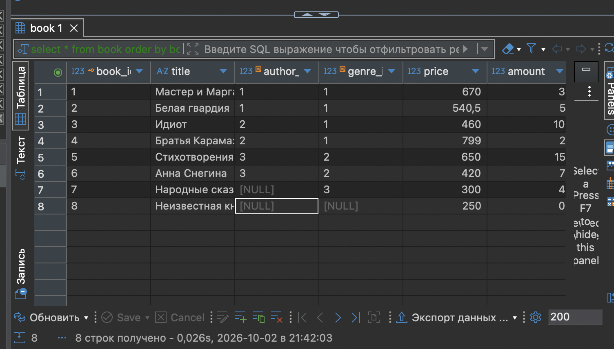

### 1.2. Получить все данные об авторах.

```sql
SELECT * FROM author ORDER BY author_id;
```

Символ * выбирает все столбцы таблицы авторов.

**Результат выполнения запроса — фото:**

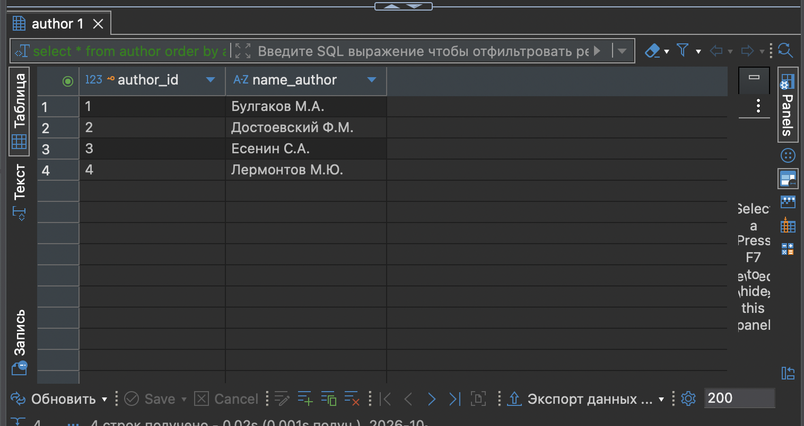

## 2. Выборка отдельных столбцов

### 2.1. Получить названия и цены книг.

```sql
SELECT title, price FROM book ORDER BY book_id;
```

Выбираются только название и цена.

**Результат выполнения запроса — фото:**

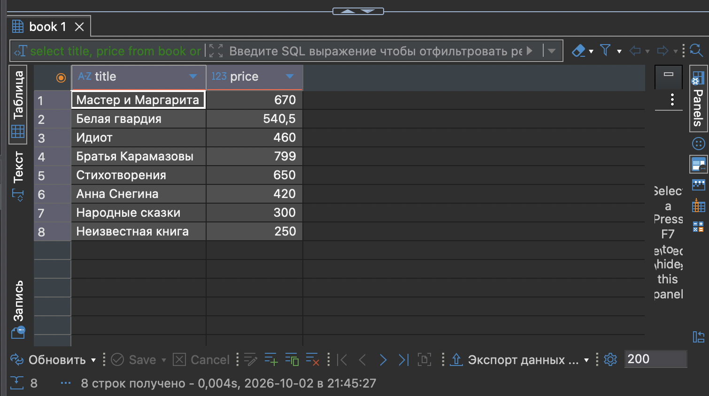

### 2.2. Получить названия книг и их количество.

```sql
SELECT title, amount FROM book ORDER BY book_id;
```

Выбираются только название и количество экземпляров.

**Результат выполнения запроса — фото:**

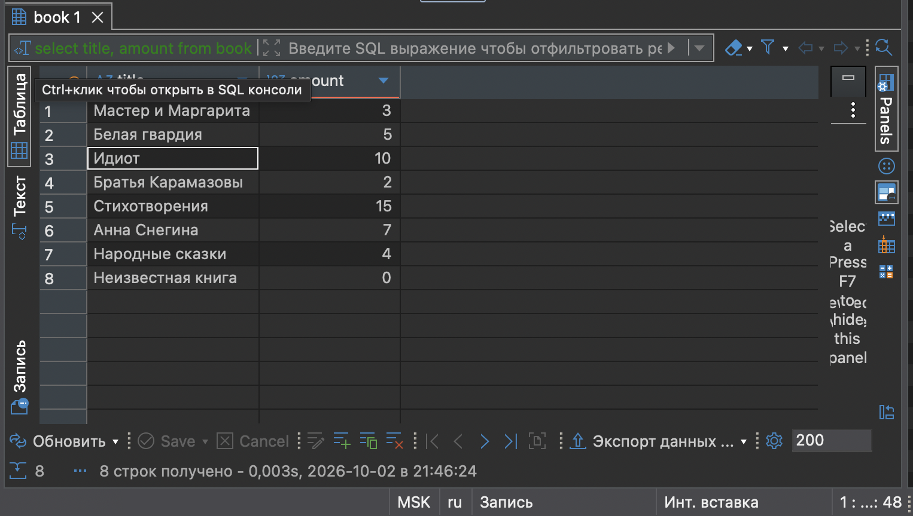

## 3. Присвоение новых имен столбцам при формировании выборки

### 3.1. Переименовать название книги и цену в результате.

```sql
SELECT title AS "Название", price AS "Цена"
FROM book ORDER BY book_id;
```

AS задаёт названия столбцов в результате, не изменяя таблицу.

**Результат выполнения запроса — фото:**

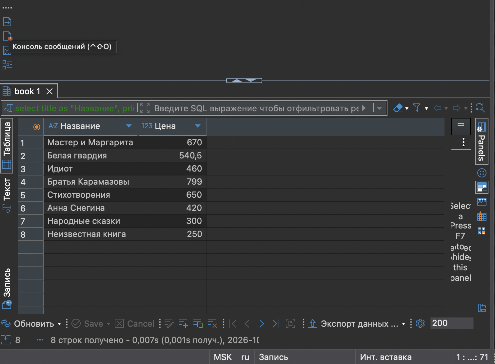

### 3.2. Вывести идентификаторы и имена авторов с русскими названиями столбцов.

```sql
SELECT author_id AS "Айди-автора", name_author AS "Имя автора"
FROM author
ORDER BY author_id;
```

AS задаёт русские псевдонимы столбцов.

**Результат выполнения запроса — фото:**

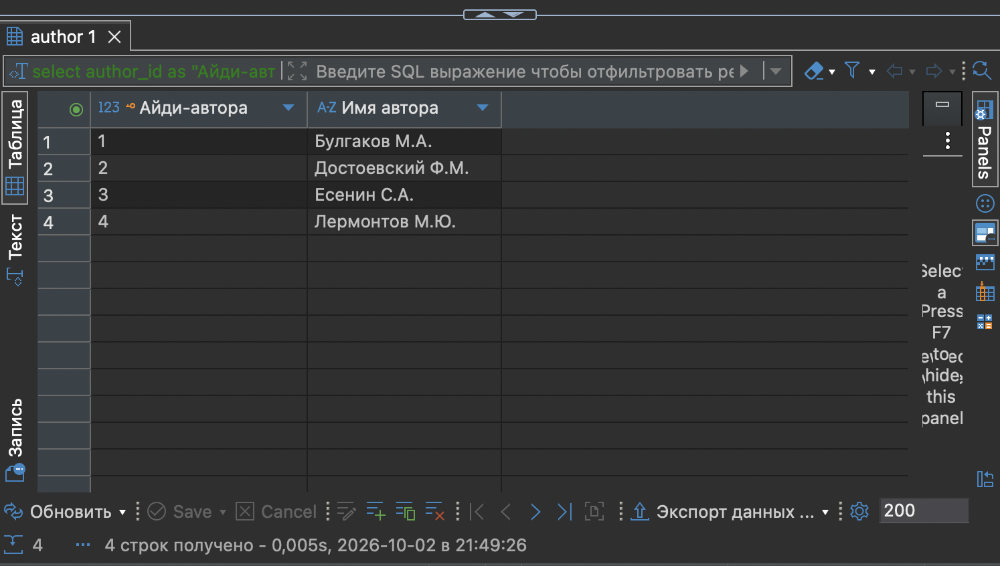

## 4. Выборка данных с созданием вычисляемого столбца

### 4.1. Рассчитать стоимость всех экземпляров каждой книги.

```sql
SELECT title, price, amount, price * amount AS total
FROM book ORDER BY book_id;
```

Цена умножается на количество; вычисляемый столбец называется total.

**Результат выполнения запроса — фото:**

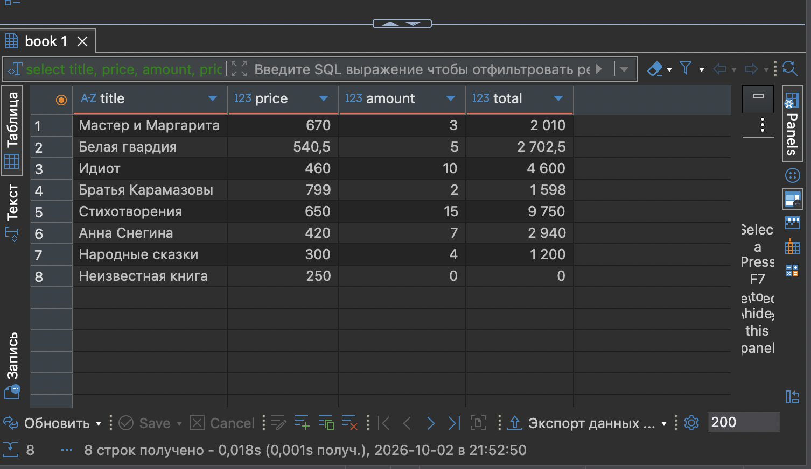

### 4.2. Вычислить цену каждой книги после скидки 10%.

```sql
SELECT title, price, ROUND(price * 0.90, 2) AS price_with_discount
FROM book
ORDER BY book_id;
```

После скидки 10% остаётся 90% цены; ROUND округляет до двух знаков.

**Результат выполнения запроса — фото:**

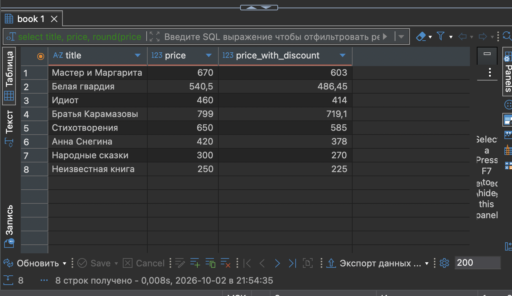

## 5. Выборка данных, вычисляемые столбцы, математические функции

### 5.1. Вычислить условный налог 15%, включённый в цену, и цену без него.

```sql
SELECT title,
       ROUND(price * 15 / 115.0, 2) AS tax,
       ROUND(price / 1.15, 2) AS price_without_tax
FROM book
ORDER BY book_id;
```

В этом учебном примере налог уже включён в цену. Деление на 1.15 даёт цену без налога.

**Результат выполнения запроса — фото:**

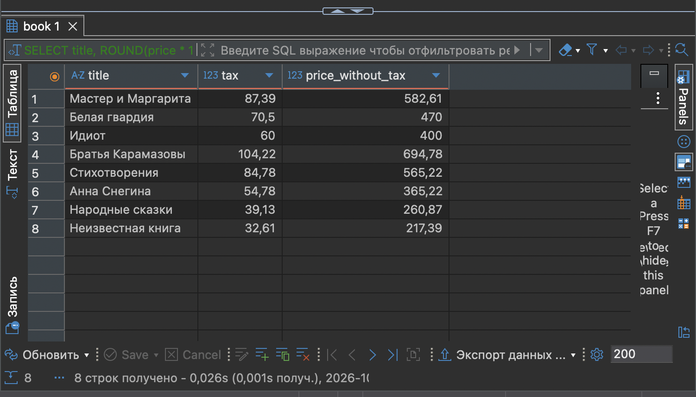

### 5.2. Вычислить квадратный корень из количества и квадрат количества.

```sql
SELECT title,
       ROUND(SQRT(CAST(amount AS NUMERIC)), 2) AS amount_sqrt,
       POWER(amount, 2) AS amount_square
FROM book
ORDER BY book_id;
```

SQRT вычисляет квадратный корень, POWER — степень; CAST задаёт числовой тип для округления.

**Результат выполнения запроса — фото:**

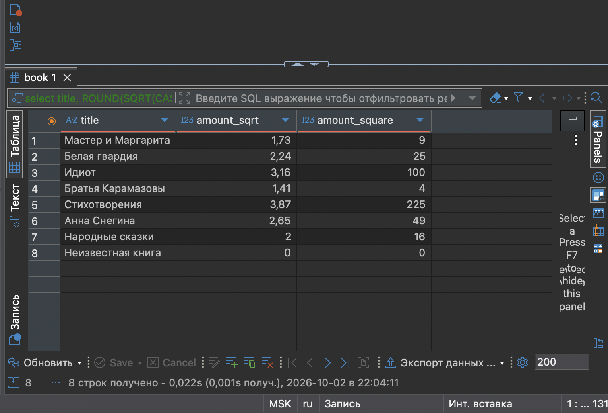

## 6. Выборка данных, вычисляемые столбцы, логические функции

### 6.1. Если книг меньше 4, установить скидку 50%, иначе 30%.

```sql
SELECT title, amount,
       CASE WHEN amount < 4 THEN ROUND(price * 0.50, 2)
            ELSE ROUND(price * 0.70, 2) END AS new_price
FROM book ORDER BY book_id;
```

CASE назначает скидку 50% при количестве меньше 4, иначе 30%.

**Результат выполнения запроса — фото:**

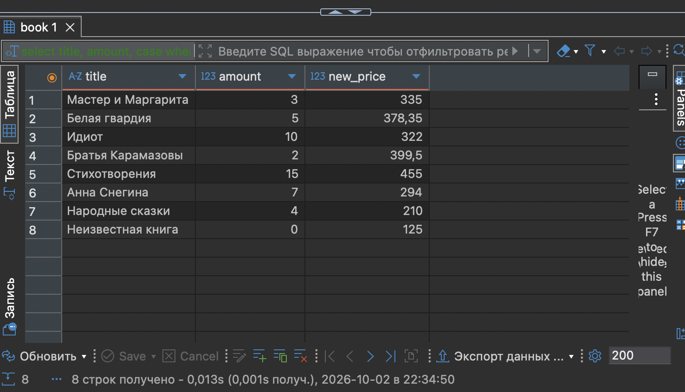

### 6.2. Разделить книги на отсутствующие, с малым остатком и доступные.

```sql
SELECT title, amount,
       CASE WHEN amount = 0 THEN 'Нет в наличии'
            WHEN amount < 5 THEN 'Мало'
            ELSE 'В наличии' END AS stock_status
FROM book ORDER BY book_id;
```

CASE проверяет остаток по порядку: ноль, меньше пяти, остальные значения.

**Результат выполнения запроса — фото:**

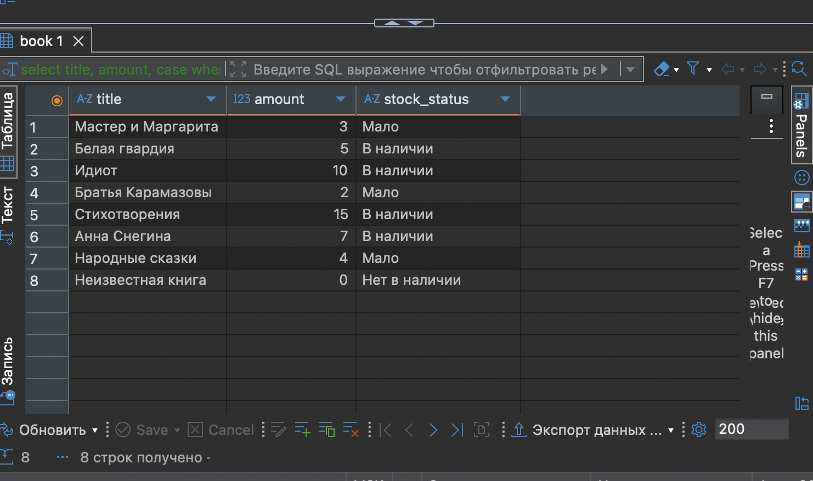

## 7. Выборка данных по условию

### 7.1. Вывести название, цену и количество книг дороже 400 рублей.

```sql
SELECT title, price, amount
FROM book
WHERE price > 400
ORDER BY book_id;
```

WHERE оставляет строки с ценой больше 400 рублей.

**Результат выполнения запроса — фото:**

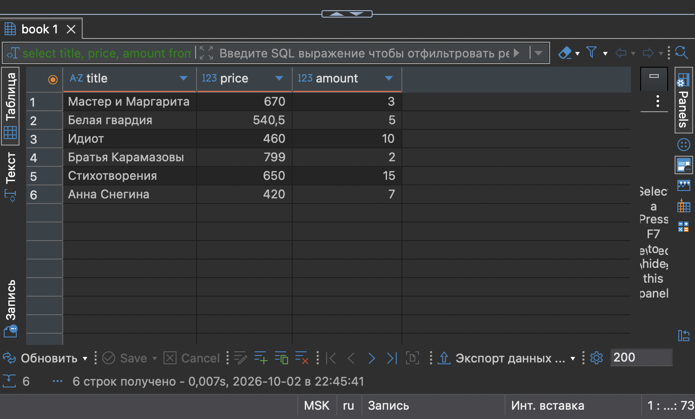

### 7.2. Вывести книги, стоимость всех экземпляров которых превышает 5000 рублей.

```sql
SELECT title, amount, price * amount AS "стоимость"
FROM book
WHERE price * amount > 5000
ORDER BY book_id;
```

WHERE проверяет произведение цены и количества.

**Результат выполнения запроса — фото:**

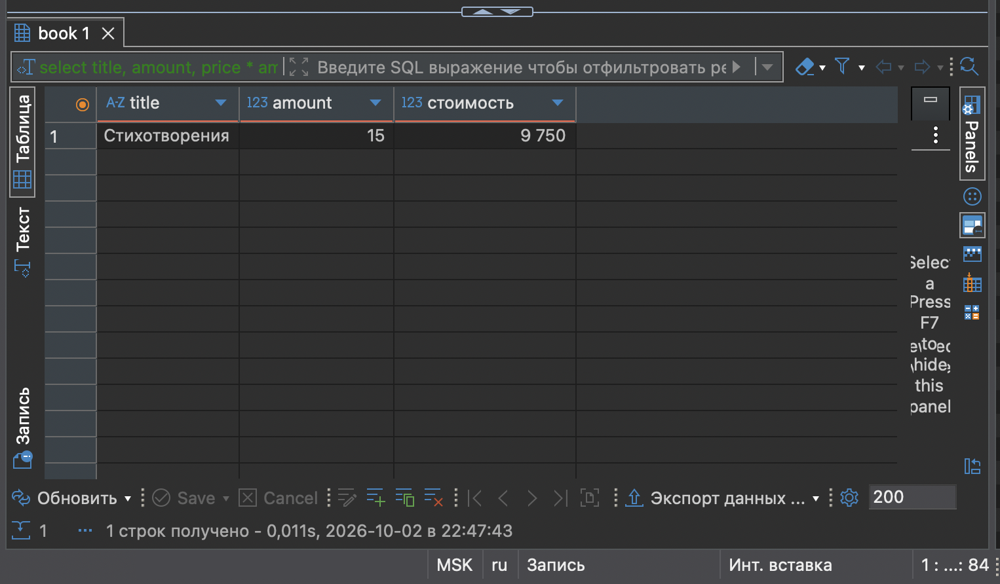

## 8. Выборка данных, логические операции

### 8.1. Вывести книги Достоевского дороже 600 рублей.

```sql
SELECT title, price
FROM book
WHERE author_id = 2 AND price > 600
ORDER BY book_id;
```

AND требует выполнения обоих условий.

**Результат выполнения запроса — фото:**

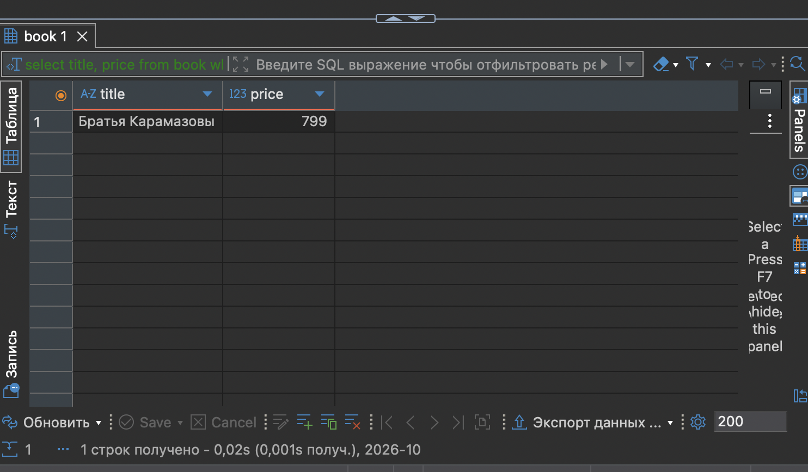

### 8.2. Вывести книги Достоевского или Есенина дороже 400 рублей.

```sql
SELECT title, price
FROM book
WHERE (author_id = 2 OR author_id = 3) AND NOT (price <= 400)
ORDER BY book_id;
```

OR допускает одного из двух авторов; AND добавляет ограничение по цене; NOT отрицает условие.

**Результат выполнения запроса — фото:**

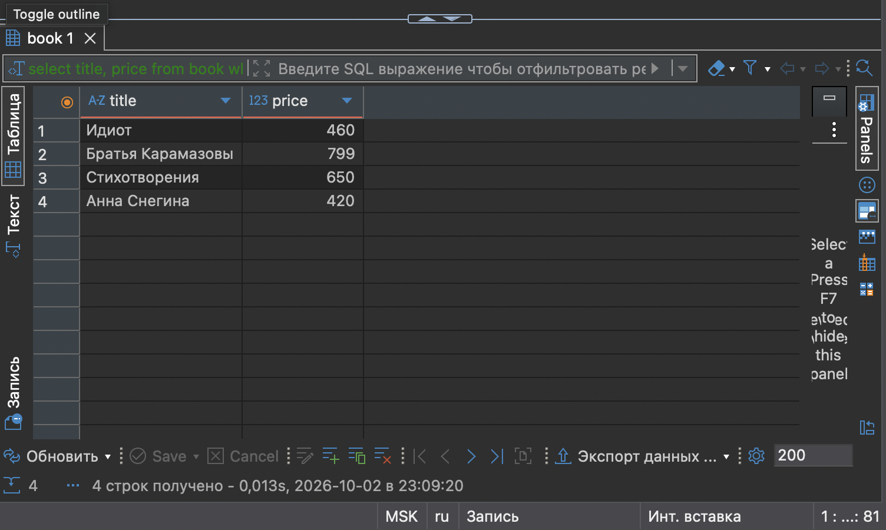

## 9. Выборка данных, операторы BETWEEN, IN

### 9.1. Вывести книги с количеством от 2 до 5 включительно.

```sql
SELECT title, amount
FROM book
WHERE amount BETWEEN 2 AND 5
ORDER BY book_id;
```

BETWEEN включает обе границы диапазона.

**Результат выполнения запроса — фото:**

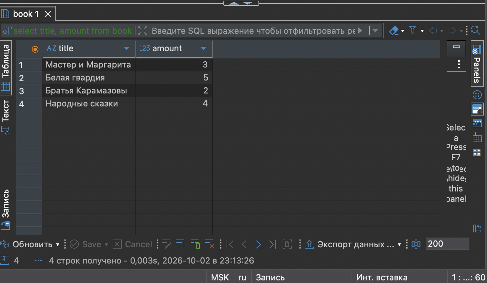

### 9.2. Вывести книги с ценой от 250 до 700 рублей включительно.

```sql
SELECT title, price
FROM book
WHERE price BETWEEN 250 AND 700
ORDER BY book_id;
```

В результат входят обе границы: 250 и 700.

**Результат выполнения запроса — фото:**

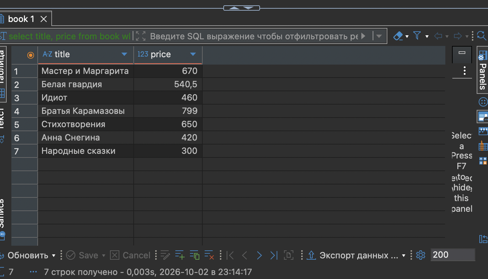

### 9.3. Вывести книги автора с идентификатором 2.

```sql
SELECT title, price, amount
FROM book
WHERE author_id IN (2)
ORDER BY book_id;
```

IN проверяет вхождение значения в список, здесь список содержит один номер.

**Результат выполнения запроса — фото:**

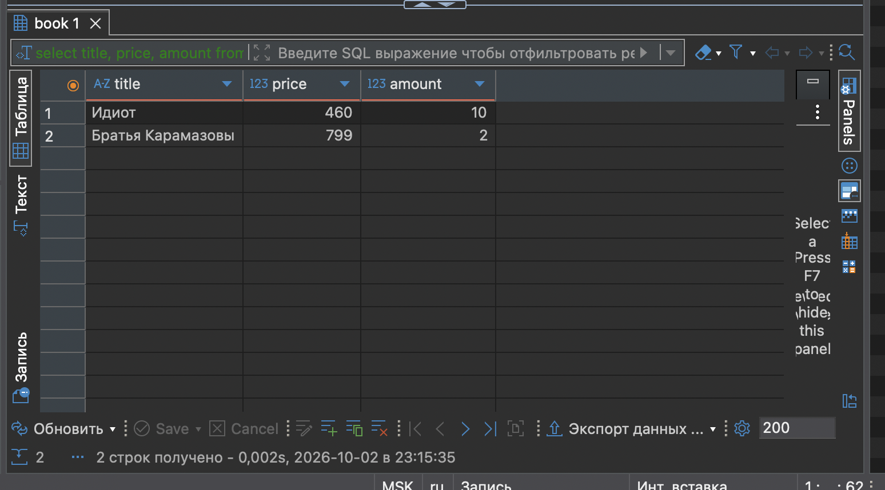

### 9.4. Вывести книги с количеством 0, 3 или 5 экземпляров.

```sql
SELECT title, price, amount
FROM book
WHERE amount IN (0, 3, 5)
ORDER BY book_id;
```

IN оставляет только указанные значения количества.

**Результат выполнения запроса — фото:**

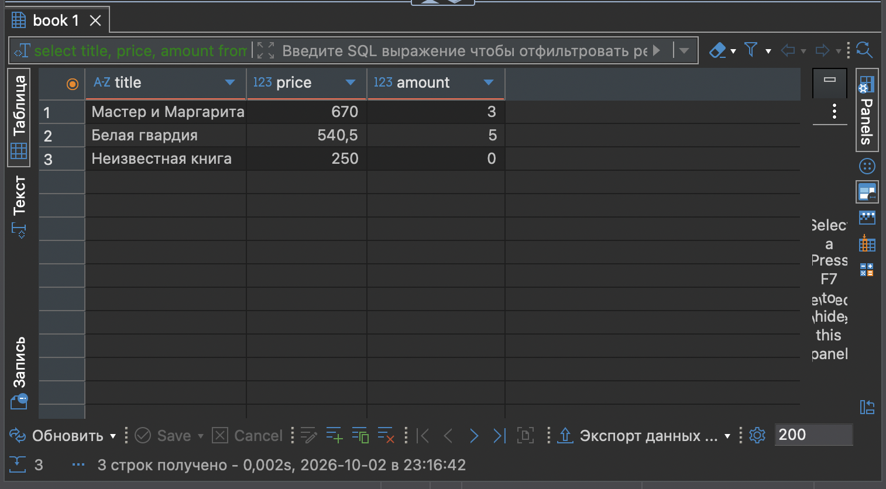

## 10. Выборка данных с сортировкой

### 10.1. Отсортировать книги по цене от дорогих к дешёвым.

```sql
SELECT title, price FROM book
ORDER BY price DESC, book_id ASC;
```

DESC задаёт убывание цены; при совпадении цены используется номер книги.

**Результат выполнения запроса — фото:**

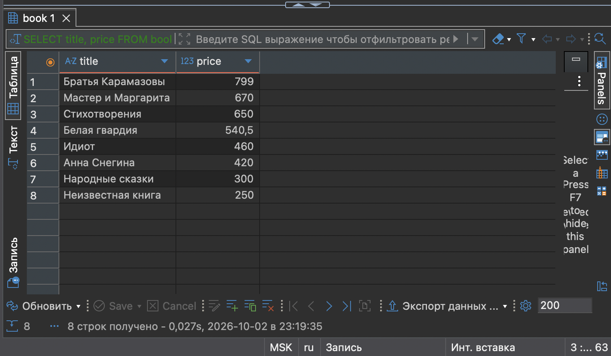

### 10.2. Отсортировать книги дешевле 750 рублей по автору, затем по убыванию количества.

```sql
SELECT author_id, title, amount FROM book WHERE price < 750
ORDER BY author_id ASC NULLS LAST, amount DESC, book_id ASC;
```

Сортировка идёт по автору, затем по убыванию количества; NULLS LAST помещает неизвестных авторов в конец.

**Результат выполнения запроса — фото:**

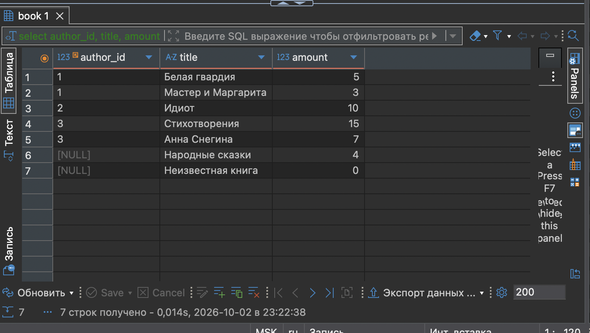

## 11. Выборка данных, оператор LIKE

### 11.1. Вывести названия и количество книг, начинающихся с буквы М.

```sql
SELECT title, amount
FROM book
WHERE title LIKE 'М%'
ORDER BY book_id;
```

Знак % обозначает любое количество символов после буквы М.

**Результат выполнения запроса — фото:**

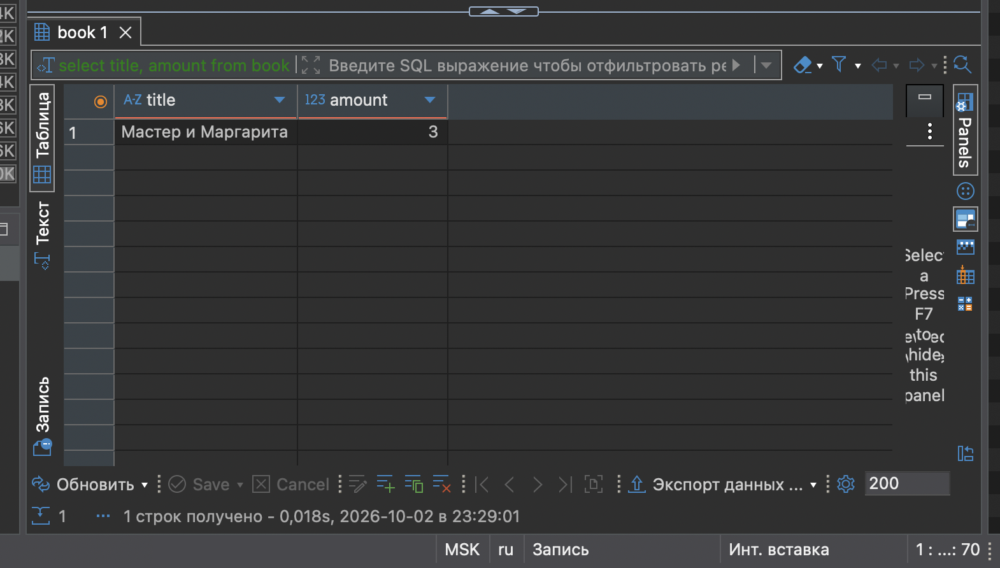

### 11.2. Вывести названия и количество книг, название которых состоит из 17 символов.

```sql
SELECT title, amount
FROM book
WHERE title LIKE '_________________'
ORDER BY book_id;
```

Каждое подчёркивание соответствует одному символу, включая пробел.

**Результат выполнения запроса — фото:**

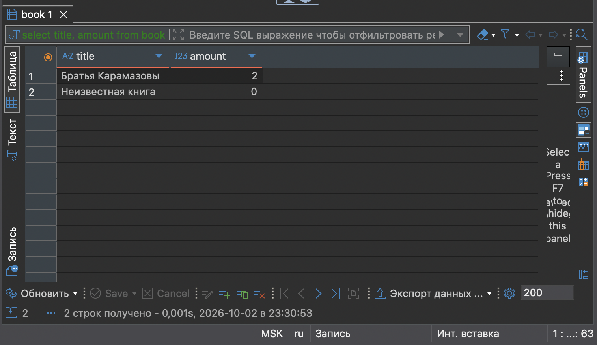

## 12. Выбор уникальных элементов столбца

### 12.1. Получить уникальные цены книг.

```sql
SELECT DISTINCT price FROM book ORDER BY price;
```

DISTINCT удаляет повторяющиеся цены.

**Результат выполнения запроса — фото:**

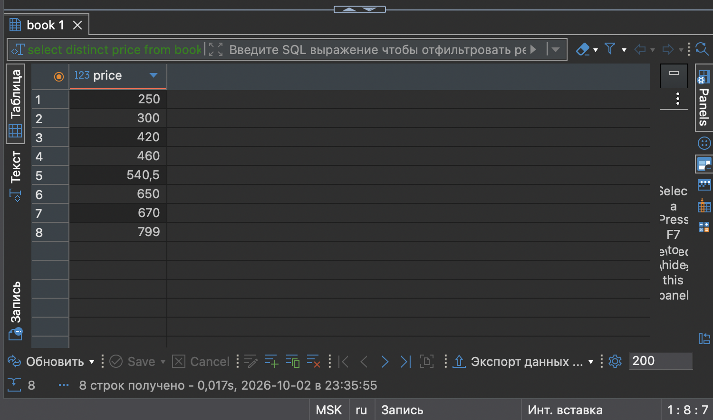

### 12.2. Получить уникальные коды авторов, встречающиеся в книгах.

```sql
SELECT DISTINCT author_id FROM book
WHERE author_id IS NOT NULL ORDER BY author_id;
```

DISTINCT удаляет повторяющиеся номера авторов; IS NOT NULL исключает неизвестных авторов.

**Результат выполнения запроса — фото:**

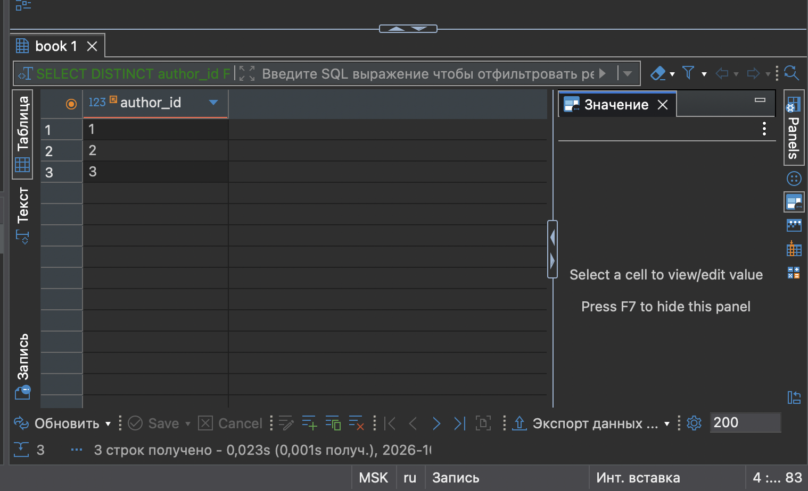

## 13. Выбор ограниченного количества возвращаемых строк

### 13.1. Вывести четыре самые дешёвые книги.

```sql
SELECT title, price
FROM book
ORDER BY price ASC, book_id
LIMIT 4;
```

Сначала сортируем по цене по возрастанию, затем LIMIT оставляет четыре строки.

**Результат выполнения запроса — фото:**

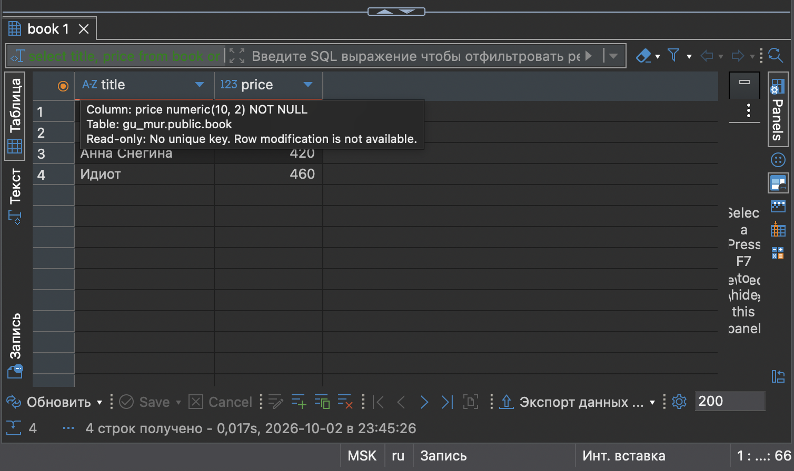

### 13.2. Пропустить первые две книги и вывести следующие четыре.

```sql
SELECT book_id, title
FROM book
ORDER BY book_id
LIMIT 4 OFFSET 2;
```

OFFSET пропускает две строки, LIMIT берёт следующие четыре.

**Результат выполнения запроса — фото:**

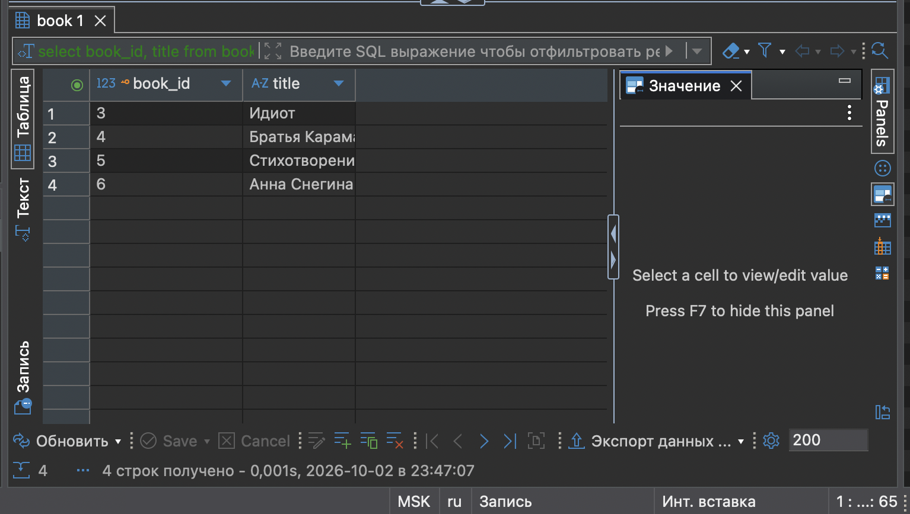

## 14. Дополнительные запросы с CASE

### 14.1. Разделить книги на ценовые категории.

```sql
SELECT title, price,
       CASE WHEN price < 400 THEN 'Бюджетная'
            WHEN price <= 650 THEN 'Средняя'
            ELSE 'Дорогая' END AS price_category
FROM book ORDER BY book_id;
```

CASE разделяет книги на бюджетные, средние и дорогие.

**Результат выполнения запроса — фото:**

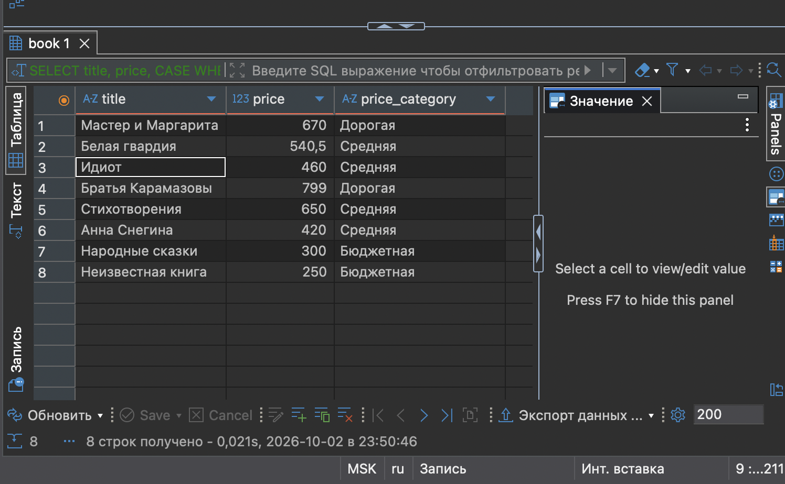

### 14.2. Использовать простой CASE для преобразования кода жанра в название.

```sql
SELECT title,
       CASE genre_id WHEN 1 THEN 'Роман'
                     WHEN 2 THEN 'Поэзия'
                     WHEN 3 THEN 'Сказка'
                     ELSE 'Жанр не указан' END AS genre_name
FROM book ORDER BY book_id;
```

Простой CASE сопоставляет номер жанра с названием.

**Результат выполнения запроса — фото:**

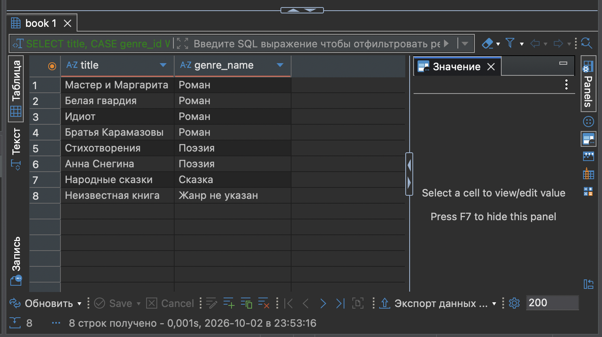

## 15. Соединение INNER JOIN

### 15.1. Получить книги с указанными авторами.

```sql
SELECT b.title, a.name_author FROM book AS b
INNER JOIN author AS a ON b.author_id = a.author_id
ORDER BY b.book_id;
```

INNER JOIN оставляет книги, для которых найден автор.

**Результат выполнения запроса — фото:**

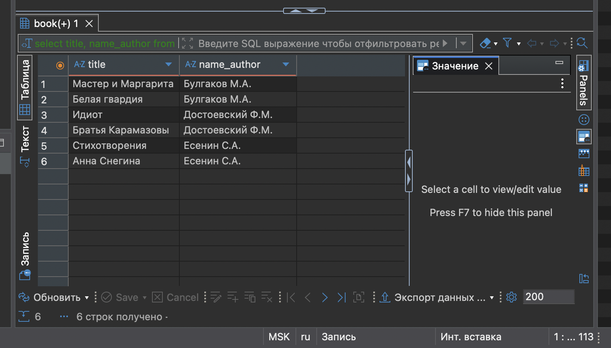

### 15.2. Получить книги дороже 500 рублей с указанными жанрами.

```sql
SELECT b.title, g.name_genre, b.price FROM book AS b
INNER JOIN genre AS g ON b.genre_id = g.genre_id
WHERE b.price > 500 ORDER BY b.book_id;
```

INNER JOIN добавляет жанр; WHERE оставляет книги дороже 500 рублей.

**Результат выполнения запроса — фото:**

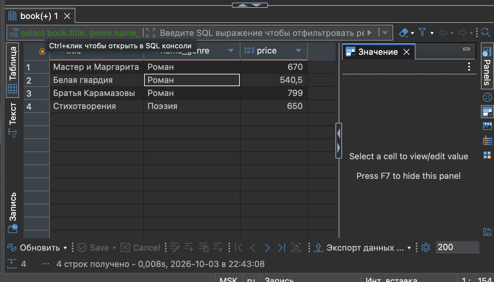

## 16. Внешнее соединение LEFT OUTER JOIN

### 16.1. Получить всех авторов и их книги, включая авторов без книг.

```sql
SELECT a.name_author, b.title FROM author AS a
LEFT OUTER JOIN book AS b ON a.author_id = b.author_id
ORDER BY a.author_id, b.book_id;
```

LEFT JOIN сохраняет всех авторов; у Лермонтова название книги будет NULL.

**Результат выполнения запроса — фото:**

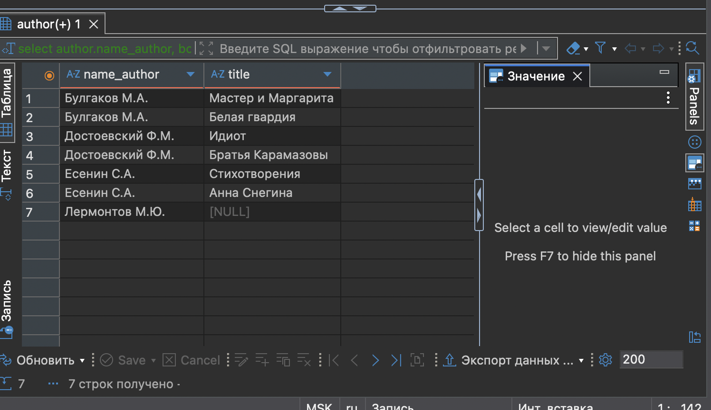

### 16.2. Получить все книги и их жанры, включая книги без жанра.

```sql
SELECT b.title, g.name_genre FROM book AS b
LEFT OUTER JOIN genre AS g ON b.genre_id = g.genre_id
ORDER BY b.book_id;
```

LEFT JOIN сохраняет все книги; у книги без жанра будет NULL.

**Результат выполнения запроса — фото:**

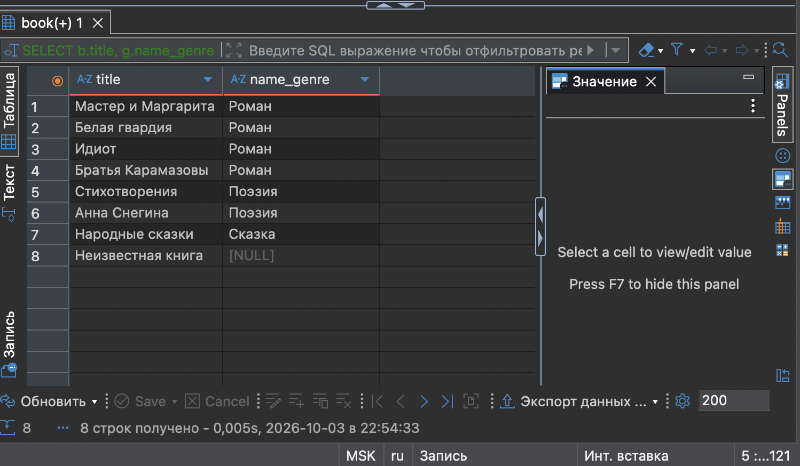

## 17. Внешнее соединение RIGHT OUTER JOIN

### 17.1. Получить всех авторов и их книги, сохраняя правую таблицу author.

```sql
SELECT a.name_author, b.title FROM book AS b
RIGHT OUTER JOIN author AS a ON b.author_id = a.author_id
ORDER BY a.author_id, b.book_id;
```

RIGHT JOIN сохраняет правую таблицу author, включая автора без книг.

**Результат выполнения запроса — фото:**

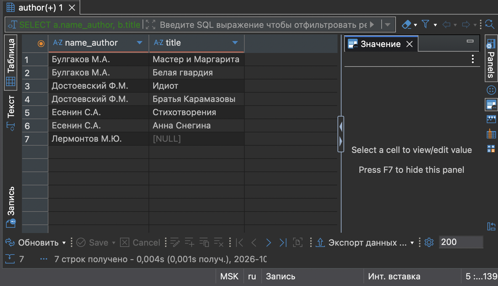

### 17.2. Получить все книги и их авторов, сохраняя правую таблицу book.

```sql
SELECT b.title, a.name_author FROM author AS a
RIGHT OUTER JOIN book AS b ON a.author_id = b.author_id
ORDER BY b.book_id;
```

RIGHT JOIN сохраняет правую таблицу book, включая книги без автора.

**Результат выполнения запроса — фото:**

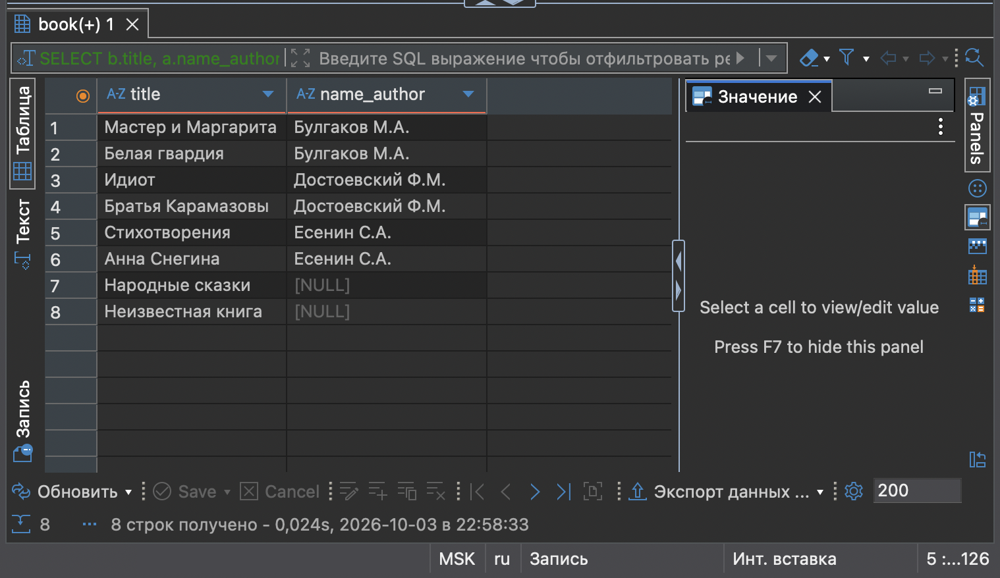

## 18. Перекрестное соединение CROSS JOIN

### 18.1. Получить все возможные пары авторов и жанров.

```sql
SELECT a.name_author, g.name_genre FROM author AS a
CROSS JOIN genre AS g ORDER BY a.author_id, g.genre_id;
```

CROSS JOIN даёт каждую возможную пару: 4 автора × 3 жанра = 12 строк.

**Результат выполнения запроса — фото:**

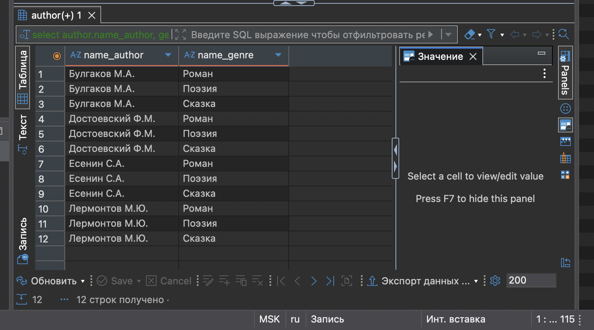

### 18.2. Получить все сочетания первых двух книг со всеми жанрами.

```sql
SELECT b.title, g.name_genre FROM book AS b
CROSS JOIN genre AS g WHERE b.book_id IN (1, 2)
ORDER BY b.book_id, g.genre_id;
```

Две книги сочетаются с тремя жанрами, получается 6 строк.

**Результат выполнения запроса — фото:**

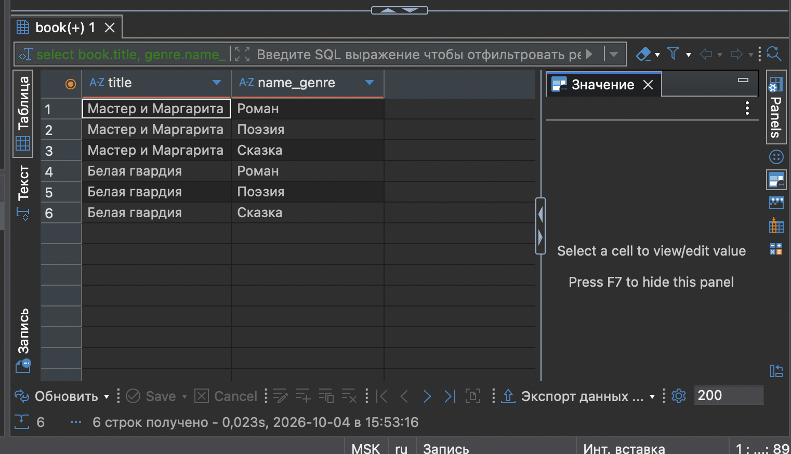

## 19. Полное внешнее соединение FULL OUTER JOIN

### 19.1. Получить всех авторов и все книги, включая авторов без книг и книги без авторов.

```sql
SELECT a.name_author, b.title FROM author AS a
FULL OUTER JOIN book AS b ON a.author_id = b.author_id
ORDER BY a.author_id NULLS LAST, b.book_id;
```

FULL JOIN сохраняет совпадения, авторов без книг и книги без авторов.

**Результат выполнения запроса — фото:**

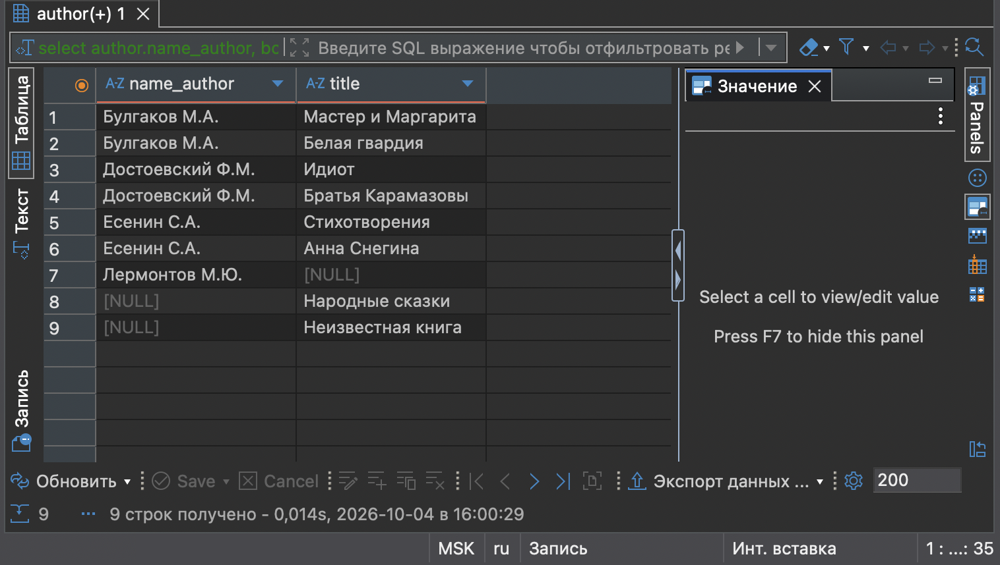

### 19.2. Получить все жанры и все книги, включая книги без жанра.

```sql
SELECT g.name_genre, b.title FROM genre AS g
FULL OUTER JOIN book AS b ON g.genre_id = b.genre_id
ORDER BY g.genre_id NULLS LAST, b.book_id;
```

FULL JOIN сохраняет все жанры и книги, даже если совпадения нет.

**Результат выполнения запроса — фото:**

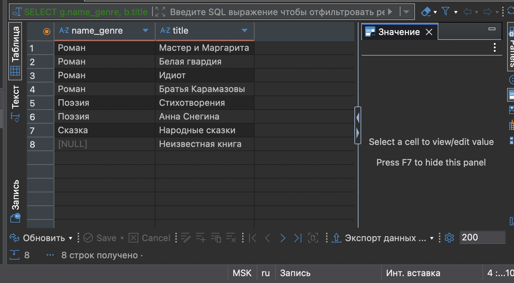

## 20. Запросы на выборку из нескольких таблиц

### 20.1. Получить названия книг, их авторов и жанры из трёх таблиц.

```sql
SELECT b.title, a.name_author, g.name_genre FROM book AS b
INNER JOIN author AS a ON b.author_id = a.author_id
INNER JOIN genre AS g ON b.genre_id = g.genre_id
ORDER BY b.book_id;
```

Два INNER JOIN связывают книгу с автором и жанром.

**Результат выполнения запроса — фото:**

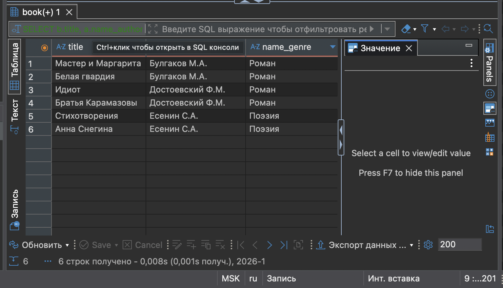

### 20.2. Вывести романы с авторами и жанрами по убыванию цены.

```sql
SELECT b.title, a.name_author, g.name_genre
FROM book AS b
INNER JOIN author AS a ON b.author_id = a.author_id
INNER JOIN genre AS g ON b.genre_id = g.genre_id
WHERE g.name_genre = 'Роман'
ORDER BY b.price DESC, b.book_id;
```

После соединения трёх таблиц выбираются романы и сортируются по цене.

**Результат выполнения запроса — фото:**

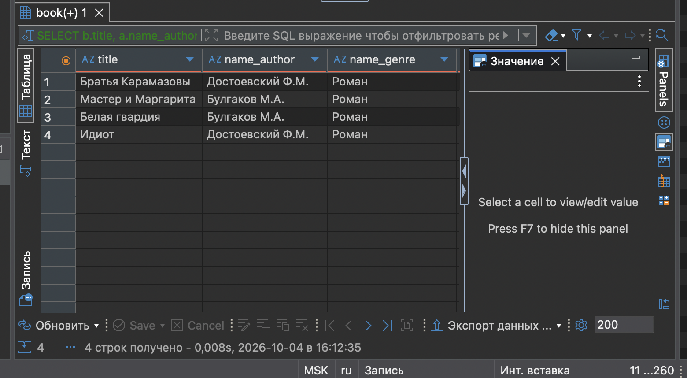
