# HW5. Агрегатные функции и группировки

СУБД: PostgreSQL. База данных: книжный магазин (`book`, `author`, `genre`).

## 1. COUNT()

### 1.1. Количество всех книг в таблице

```sql
SELECT COUNT(*) AS book_count
FROM book;
```

**Результат выполнения запроса:**

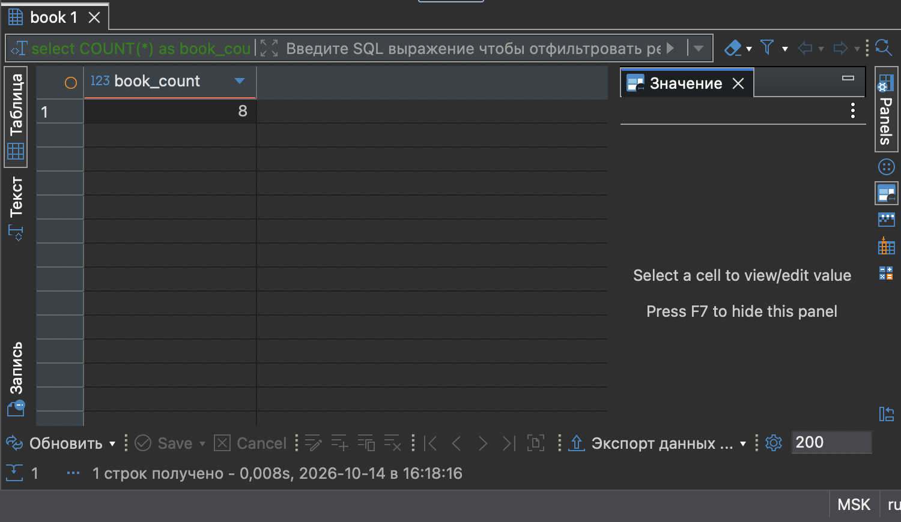

### 1.2. Количество книг с указанным автором

```sql
SELECT COUNT(author_id) AS books_with_author
FROM book;
```

**Результат выполнения запроса:**

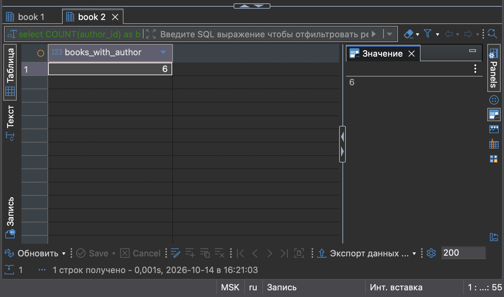

## 2. SUM()

### 2.1. Общее количество экземпляров книг

```sql
SELECT SUM(amount) AS total_amount
FROM book;
```

**Результат выполнения запроса:**

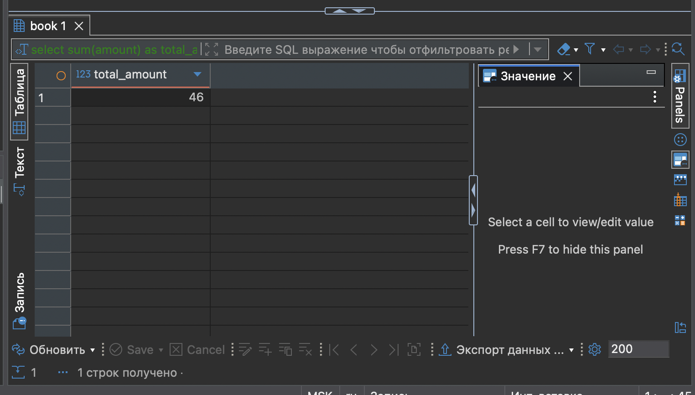

### 2.2. Общая стоимость всех экземпляров

```sql
SELECT SUM(price * amount) AS tottal_cost
FROM book;
```

**Результат выполнения запроса:**

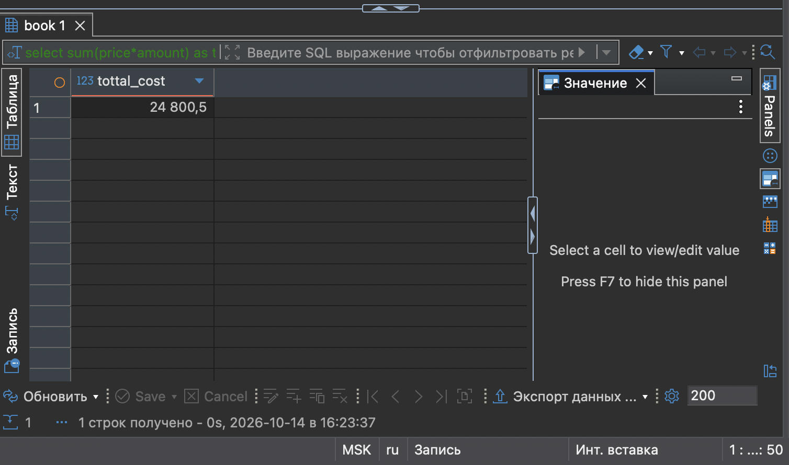

## 3. AVG()

### 3.1. Средняя цена книги

```sql
SELECT AVG(price) AS avg_price
FROM book;
```

**Результат выполнения запроса:**

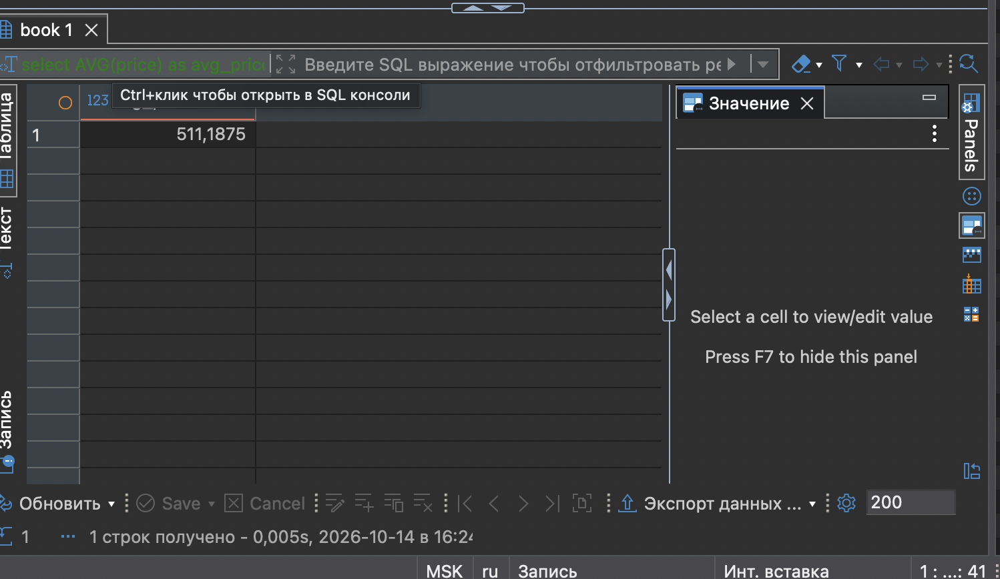

### 3.2. Среднее количество экземпляров

```sql
SELECT AVG(amount) AS avg_amount
FROM book;
```

**Результат выполнения запроса:**

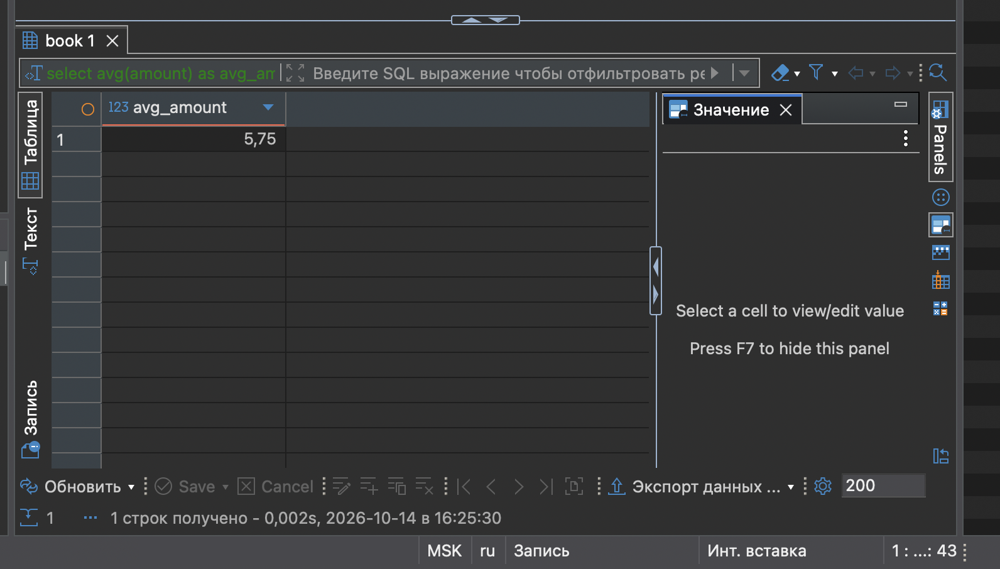

## 4. MIN()

### 4.1. Минимальная цена

```sql
SELECT MIN(price) AS min_price
FROM book;
```

**Результат выполнения запроса:**

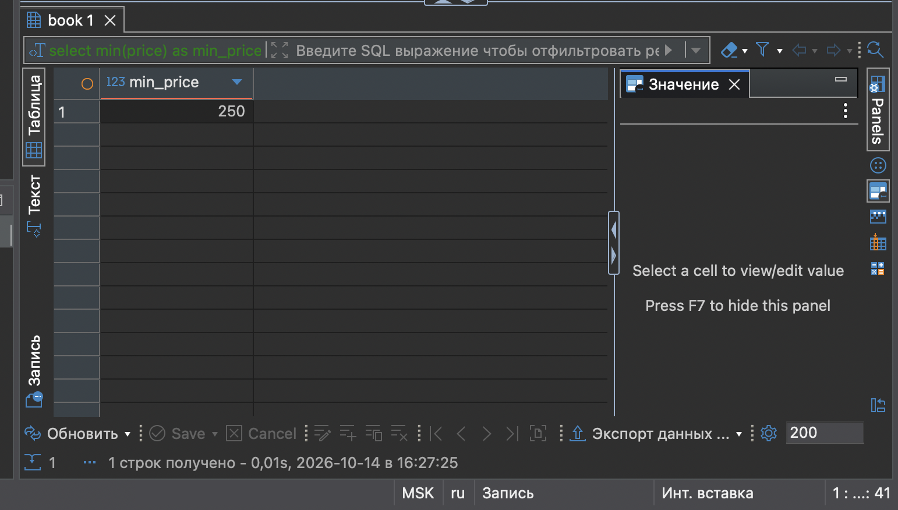

### 4.2. Минимальное количество экземпляров

```sql
SELECT MIN(amount) AS min_amount
FROM book;
```

**Результат выполнения запроса:**


## 5. MAX()

### 5.1. Максимальная цена

```sql
SELECT MAX(price) AS maximum_price
FROM book;
```

**Результат выполнения запроса:**

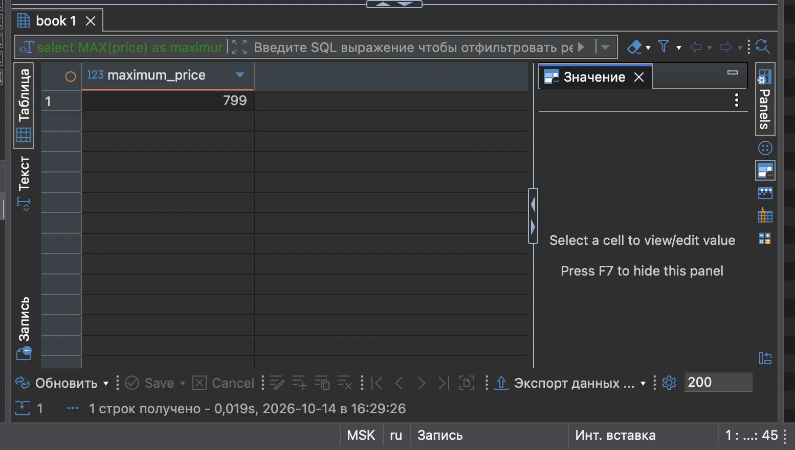

### 5.2. Максимальное количество экземпляров

```sql
SELECT MAX(amount) AS max_amount
FROM book;
```

**Результат выполнения запроса:**

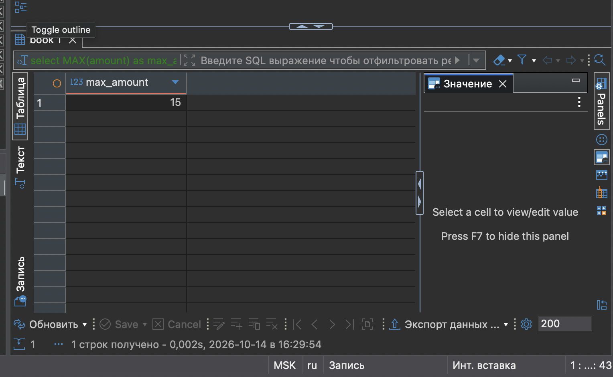

## 6. STRING_AGG()

### 6.1. Названия всех книг одной строкой

```sql
SELECT STRING_AGG(title, ', ' ORDER BY title) AS zook_titles
FROM book;
```

**Результат выполнения запроса:**

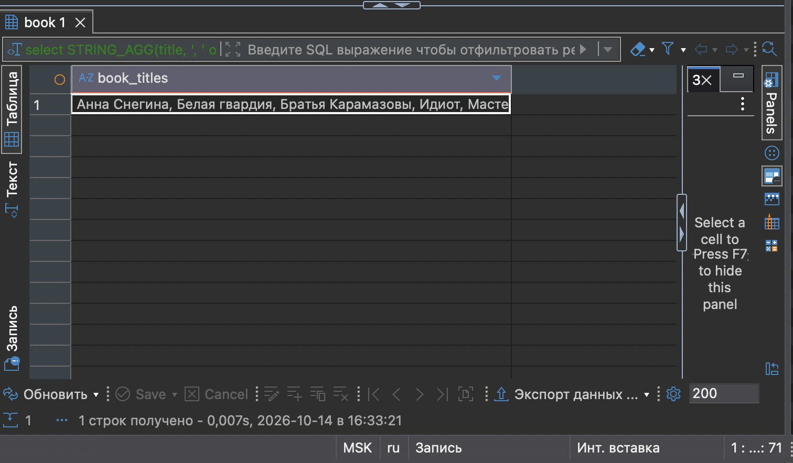

### 6.2. Авторы одной строкой

```sql
SELECT STRING_AGG(name_author, '; ' ORDER BY name_author) AS authors
FROM author;
```

**Результат выполнения запроса:**

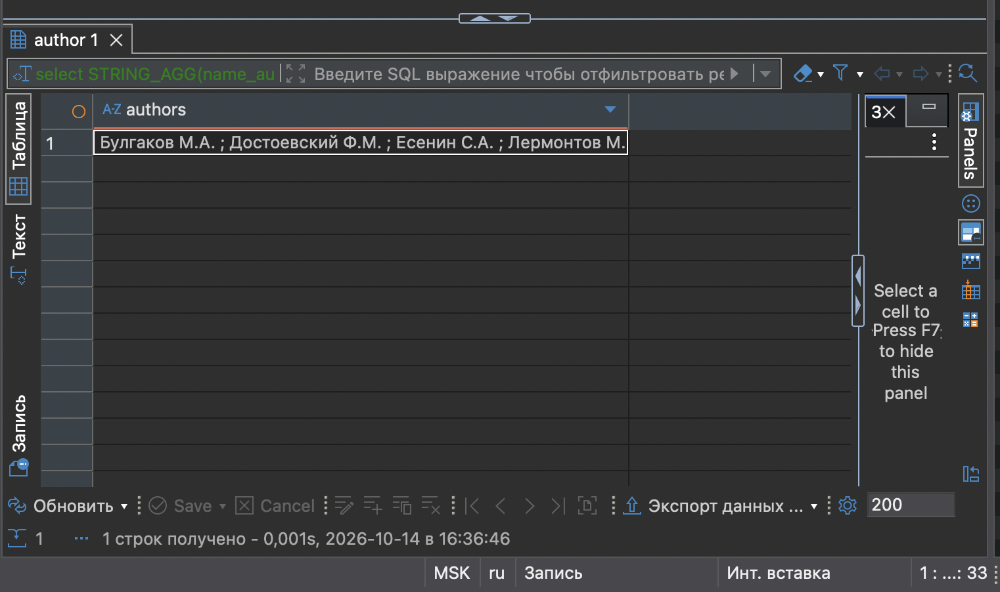

## 7. GROUP BY

### 7.1. Количество книг по авторам

```sql
SELECT author_id, COUNT(*) AS book_count
FROM book
GROUP BY author_id
ORDER BY author_id;
```

**Результат выполнения запроса:**

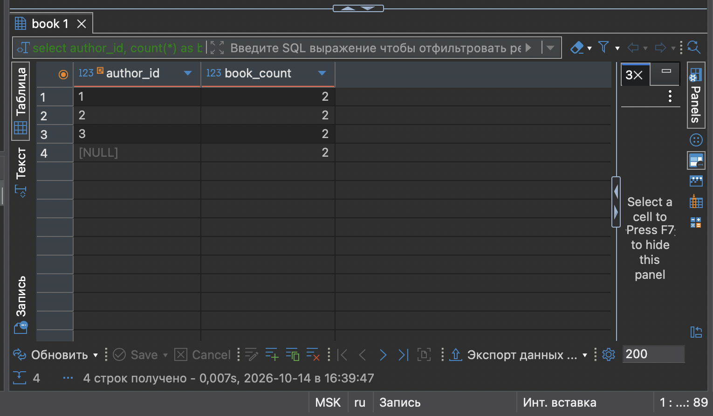

### 7.2. Количество экземпляров по жанрам

```sql
SELECT genre_id, SUM(amount) AS total_amount
FROM book
GROUP BY genre_id
ORDER BY genre_id;
```

**Результат выполнения запроса:**

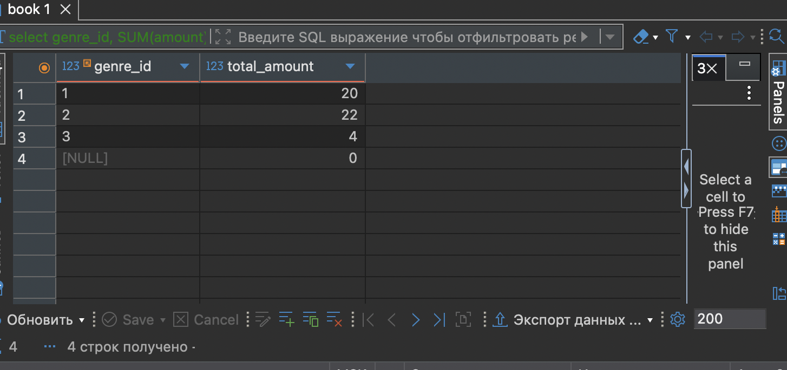

## 8. HAVING

### 8.1. Авторы, у которых больше одной книги

```sql
SELECT author_id, COUNT(*) AS book_count
FROM book
GROUP BY author_id
HAVING COUNT(*) > 1
ORDER BY author_id;
```

**Результат выполнения запроса:**

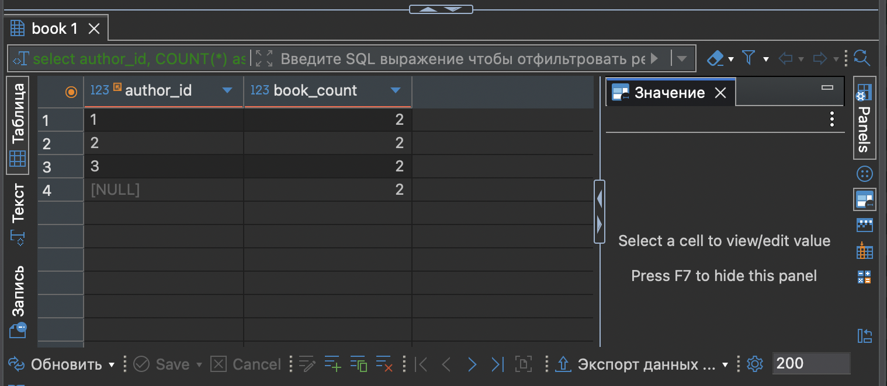

### 8.2. Жанры со средней ценой выше 500

```sql
SELECT genre_id, AVG(price) AS average_price
FROM book
GROUP BY genre_id
HAVING AVG(price) > 500
ORDER BY average_price DESC;
```

**Результат выполнения запроса:**

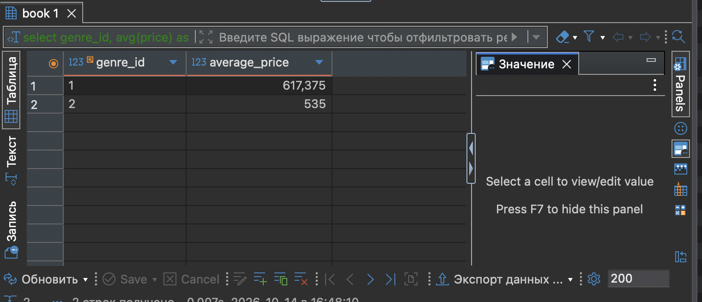

## 9. GROUPING SETS

### 9.1. Количество книг отдельно по авторам и по жанрам

```sql
SELECT author_id, genre_id,
       GROUPING(author_id) AS author_total,
       GROUPING(genre_id) AS genre_total,
       COUNT(*) AS book_count
FROM book
GROUP BY GROUPING SETS ((author_id), (genre_id))
ORDER BY author_total, genre_total, author_id, genre_id;
```

**Результат выполнения запроса:**

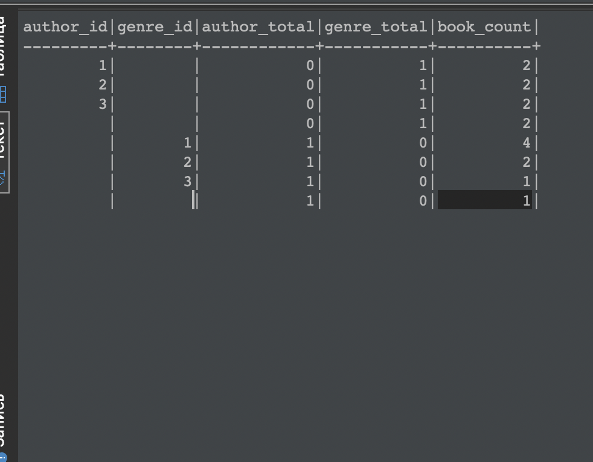

### 9.2. Остатки по парам автор–жанр и общий итог

```sql
SELECT author_id, genre_id,
       GROUPING(author_id) AS author_total,
       GROUPING(genre_id) AS genre_total,
       SUM(amount) AS total_amount
FROM book
GROUP BY GROUPING SETS ((author_id, genre_id), ())
ORDER BY author_total, genre_total, author_id, genre_id;
```

**Результат выполнения запроса:**

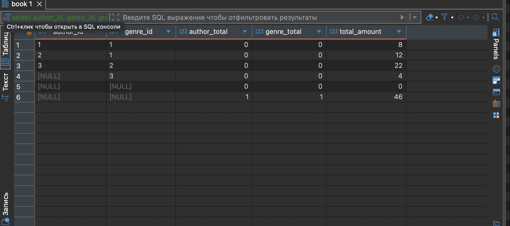

## 10. ROLLUP

### 10.1. Остатки по авторам и жанрам с промежуточными итогами

```sql
SELECT author_id, genre_id,
       GROUPING(author_id) AS author_total,
       GROUPING(genre_id) AS genre_total,
       SUM(amount) AS total_amount
FROM book
GROUP BY ROLLUP (author_id, genre_id)
ORDER BY author_total, author_id, genre_total, genre_id;
```

**Результат выполнения запроса:**

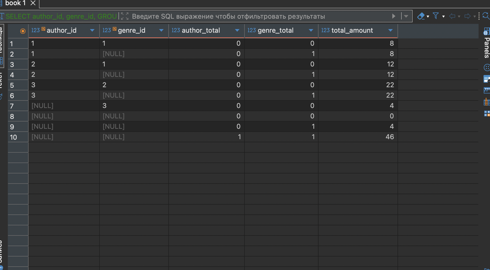 -->

### 10.2. Стоимость экземпляров по жанрам и авторам с итогами

```sql
SELECT author_id, genre_id,
       GROUPING(author_id) AS author_total,
       GROUPING(genre_id) AS genre_total,
       SUM(price * amount) AS total_cost
FROM book
GROUP BY ROLLUP (genre_id, author_id)
ORDER BY genre_total, genre_id, author_total, author_id;
```

**Результат выполнения запроса:**

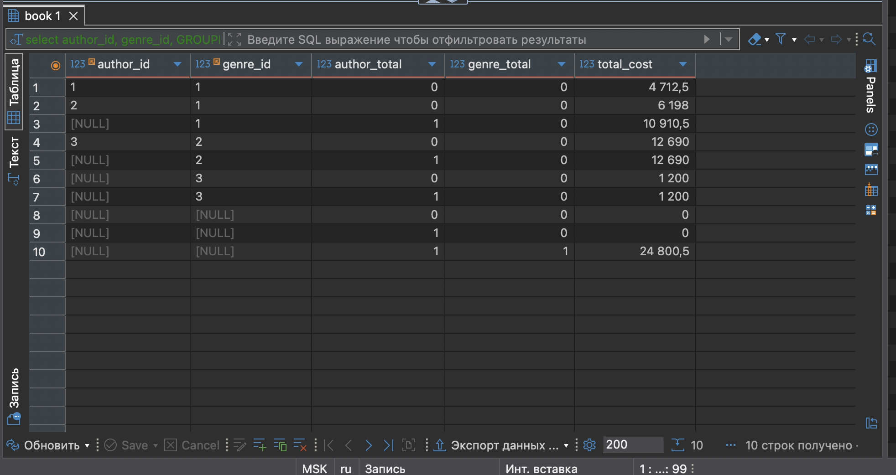

## 11. CUBE

### 11.1. Количество книг со всеми вариантами итогов

```sql
SELECT author_id, genre_id,
       GROUPING(author_id) AS author_total,
       GROUPING(genre_id) AS genre_total,
       COUNT(*) AS book_count
FROM book
GROUP BY CUBE (author_id, genre_id)
ORDER BY author_total, genre_total, author_id, genre_id;
```

**Результат выполнения запроса:**

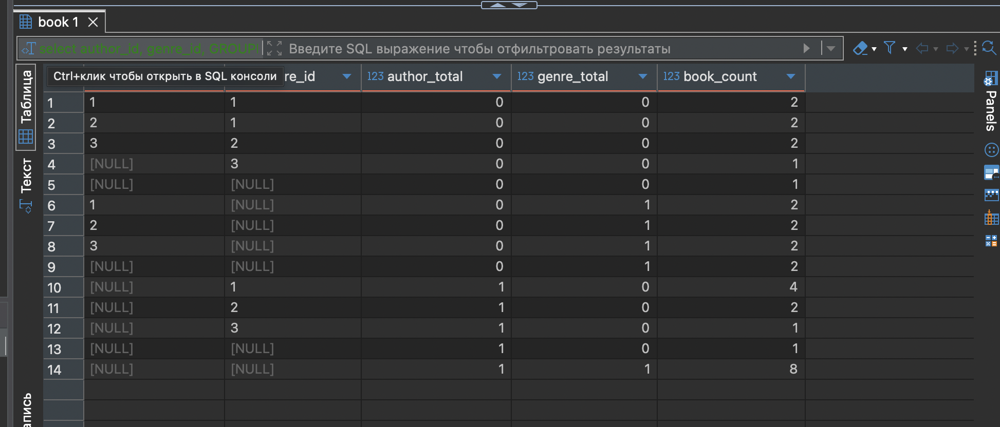

### 11.2. Стоимость экземпляров со всеми вариантами итогов

```sql
SELECT author_id, genre_id,
       GROUPING(author_id) AS author_total,
       GROUPING(genre_id) AS genre_total,
       SUM(price * amount) AS total_cost
FROM book
GROUP BY CUBE (author_id, genre_id)
ORDER BY author_total, genre_total, author_id, genre_id;
```

**Результат выполнения запроса:**

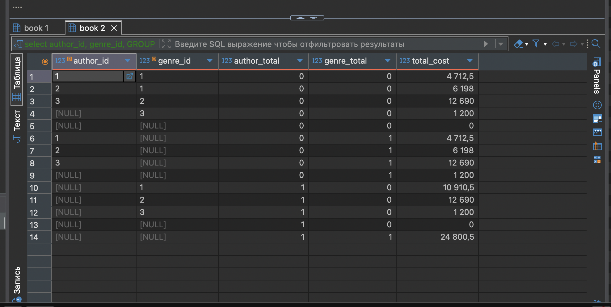

## 12. SELECT, FROM, WHERE, GROUP BY, HAVING, ORDER BY

### 12.1. Авторы, у которых минимум две книги ценой от 500

```sql
SELECT a.author_id, a.name_author, COUNT(*) AS book_count
FROM book AS b
JOIN author AS a ON b.author_id = a.author_id
WHERE b.price >= 500
GROUP BY a.author_id, a.name_author
HAVING COUNT(*) >= 2
ORDER BY book_count DESC, a.name_author;
```

**Результат выполнения запроса:**

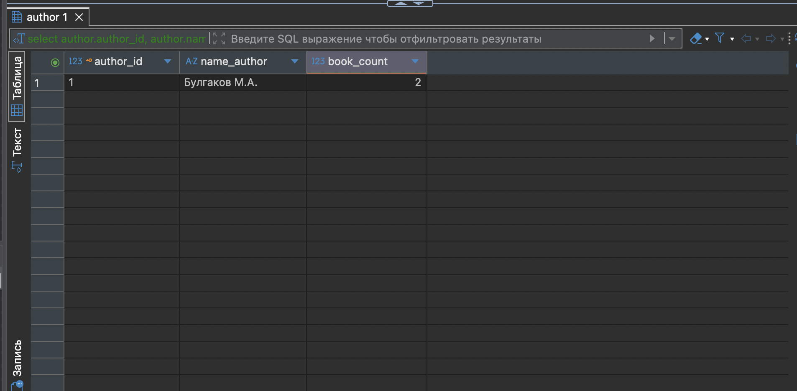

### 12.2. Жанры с остатком больше пяти экземпляров среди книг в наличии

```sql
SELECT g.genre_id, g.name_genre,
       SUM(b.amount) AS total_amount,
       AVG(b.price) AS average_price
FROM book AS b
JOIN genre AS g ON b.genre_id = g.genre_id
WHERE b.amount > 0
GROUP BY g.genre_id, g.name_genre
HAVING SUM(b.amount) > 5
ORDER BY total_amount DESC, g.name_genre;
```

**Результат выполнения запроса:**

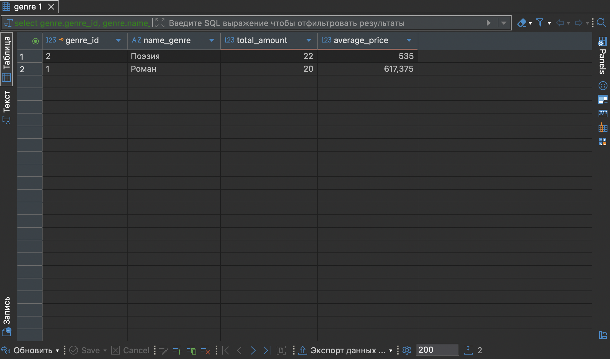

