# HW6. Подзапросы

Срок сдачи: 06.11.2026.

## 1. Подзапросы в SELECT

### 1.1. Что хотим получить

Получить цены и названия книг, а также среднюю цену всех книг.

```sql
SELECT price, title, (SELECT AVG(price) FROM book) AS average_price
FROM book;
```

РЕЗУЛЬТАТ ВЫПОЛНЕНИЯ ЗАПРОСА:

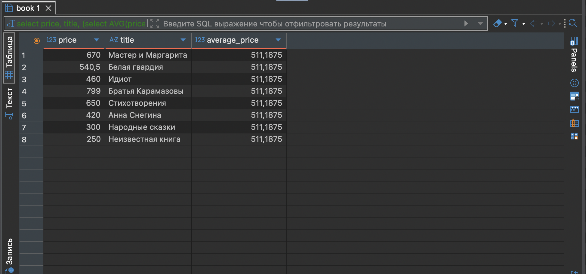

### 1.2. Что хотим получить

Получить названия книг и имена их авторов через подзапрос в SELECT.

```sql
SELECT b.title,
       (SELECT a.name_author FROM author AS a
        WHERE a.author_id = b.author_id) AS name_author
FROM book AS b;
```

РЕЗУЛЬТАТ ВЫПОЛНЕНИЯ ЗАПРОСА:

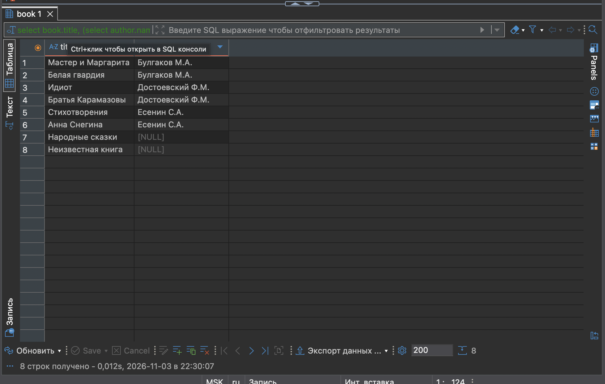

## 2. Подзапросы в FROM

### 2.1. Что хотим получить

Получить авторов, средняя цена книг которых больше 500 рублей.

```sql
SELECT a.name_author, s.average_price
FROM (
    SELECT author_id, AVG(price) AS average_price
    FROM book GROUP BY author_id
) AS s
JOIN author AS a ON a.author_id = s.author_id
WHERE s.average_price > 500;
```

РЕЗУЛЬТАТ ВЫПОЛНЕНИЯ ЗАПРОСА:

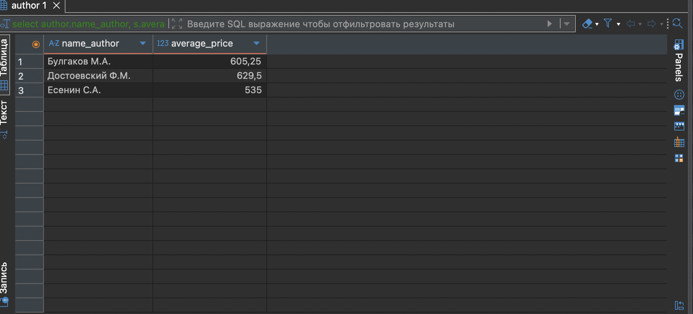

### 2.2. Что хотим получить

Получить жанры, суммарное количество экземпляров книг которых больше 10.

```sql
SELECT g.name_genre, s.total_amount
FROM (
    SELECT genre_id, SUM(amount) AS total_amount
    FROM book GROUP BY genre_id
) AS s
JOIN genre AS g ON g.genre_id = s.genre_id
WHERE s.total_amount > 10;
```

РЕЗУЛЬТАТ ВЫПОЛНЕНИЯ ЗАПРОСА:

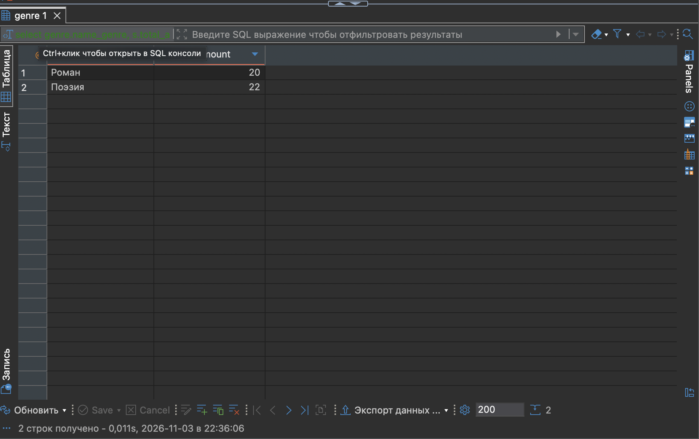

## 3. Подзапросы в WHERE

### 3.1. Что хотим получить

Получить книги, цена которых выше средней цены всех книг.

```sql
SELECT title, price FROM book
WHERE price > (SELECT AVG(price) FROM book);
```

РЕЗУЛЬТАТ ВЫПОЛНЕНИЯ ЗАПРОСА:

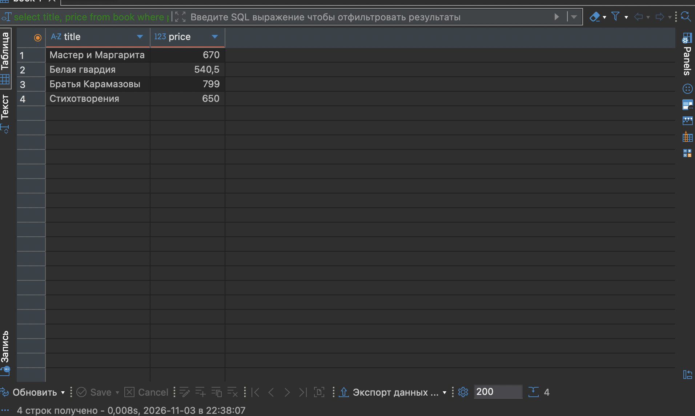

### 3.2. Что хотим получить

Получить книги с минимальной ценой.

```sql
SELECT title, price FROM book
WHERE price = (SELECT MIN(price) FROM book);
```

РЕЗУЛЬТАТ ВЫПОЛНЕНИЯ ЗАПРОСА:

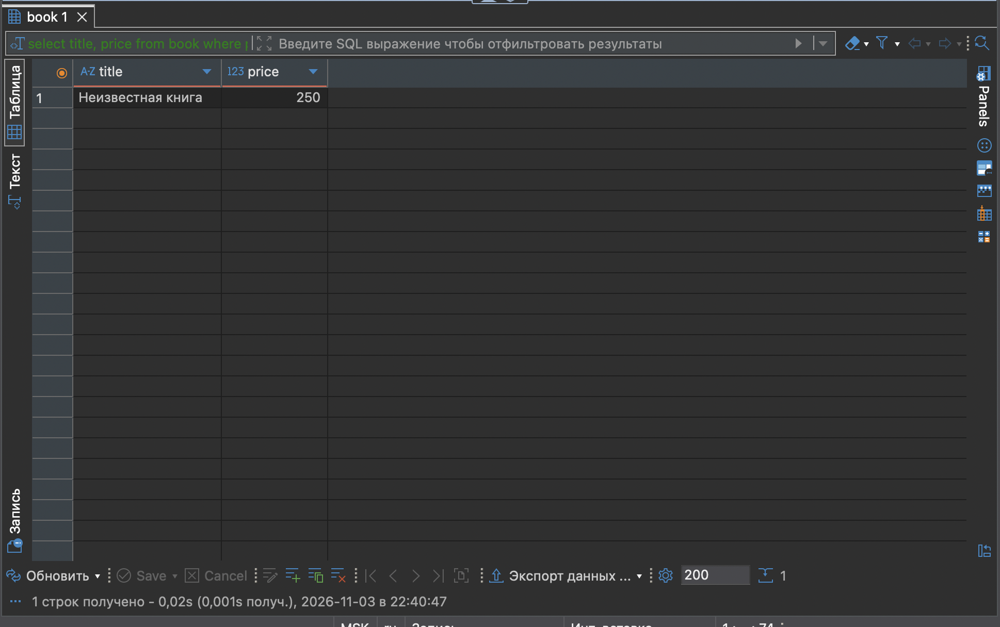

## 4. Подзапросы в HAVING

### 4.1. Что хотим получить

Получить авторов, средняя цена книг которых выше средней цены всех книг.

```sql
SELECT a.author_id, a.name_author, AVG(b.price) AS average_price
FROM author AS a
JOIN book AS b ON b.author_id = a.author_id
GROUP BY a.author_id, a.name_author
HAVING AVG(b.price) > (SELECT AVG(price) FROM book);
```

РЕЗУЛЬТАТ ВЫПОЛНЕНИЯ ЗАПРОСА:

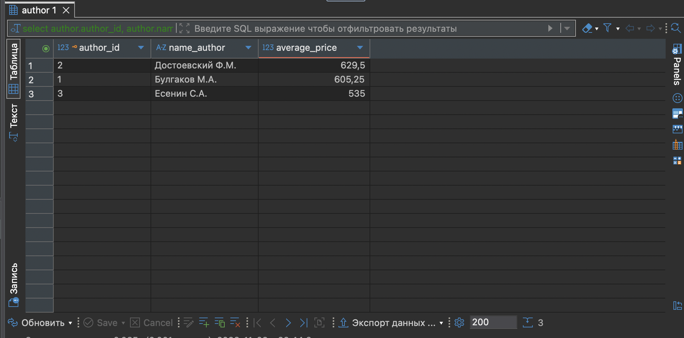

### 4.2. Что хотим получить

Получить жанры, число названий книг в которых выше среднего числа названий по жанрам, представленным в book.

```sql
SELECT g.genre_id, g.name_genre, COUNT(*) AS book_count
FROM genre AS g
JOIN book AS b ON b.genre_id = g.genre_id
GROUP BY g.genre_id, g.name_genre
HAVING COUNT(*) > (
    SELECT AVG(s.book_count)
    FROM (SELECT genre_id, COUNT(*) AS book_count
          FROM book GROUP BY genre_id) AS s
);
```

РЕЗУЛЬТАТ ВЫПОЛНЕНИЯ ЗАПРОСА:

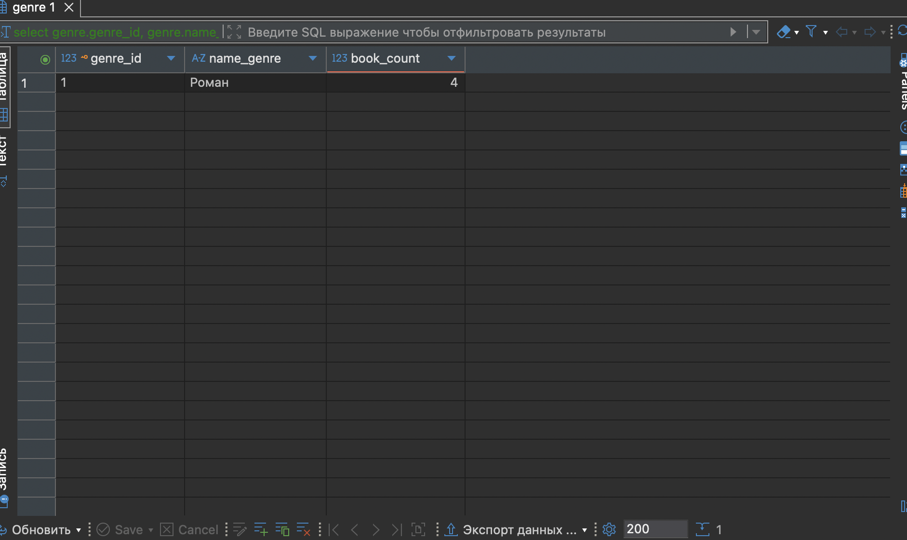

## 5. Подзапросы с ALL

### 5.1. Что хотим получить

Получить книги, которые дешевле каждой книги жанра «Роман».

```sql
SELECT title, price FROM book
WHERE price < ALL (
    SELECT b.price FROM book AS b
    JOIN genre AS g ON g.genre_id = b.genre_id
    WHERE g.name_genre = 'Роман'
);
```

РЕЗУЛЬТАТ ВЫПОЛНЕНИЯ ЗАПРОСА:

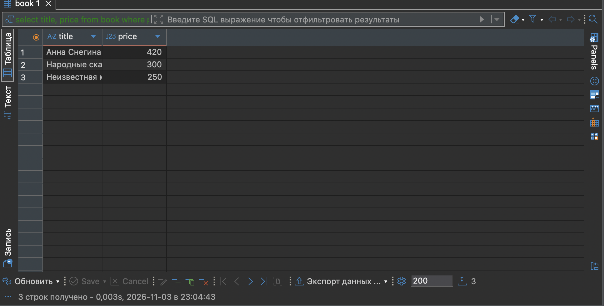

### 5.2. Что хотим получить

Получить книги, количество экземпляров которых не превышает количество экземпляров любой книги жанра «Поэзия».

```sql
SELECT title, amount FROM book
WHERE amount <= ALL (
    SELECT b.amount FROM book AS b
    JOIN genre AS g ON g.genre_id = b.genre_id
    WHERE g.name_genre = 'Поэзия'
);
```

РЕЗУЛЬТАТ ВЫПОЛНЕНИЯ ЗАПРОСА:

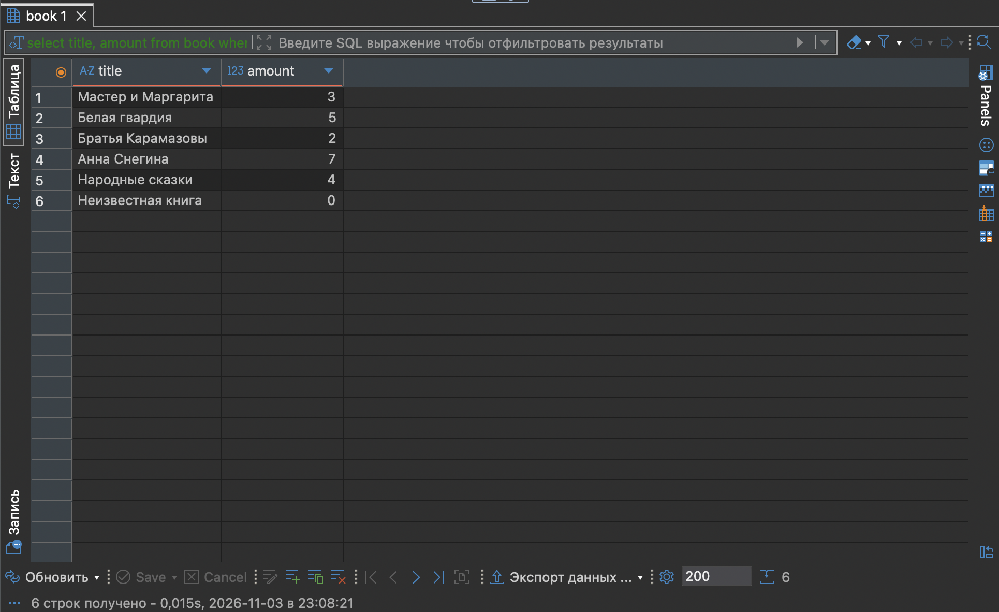

## 6. Подзапросы с IN

### 6.1. Что хотим получить

Получить все книги жанра «Роман».

```sql
SELECT title, price FROM book
WHERE genre_id IN (
    SELECT genre_id FROM genre WHERE name_genre = 'Роман'
);
```

РЕЗУЛЬТАТ ВЫПОЛНЕНИЯ ЗАПРОСА:

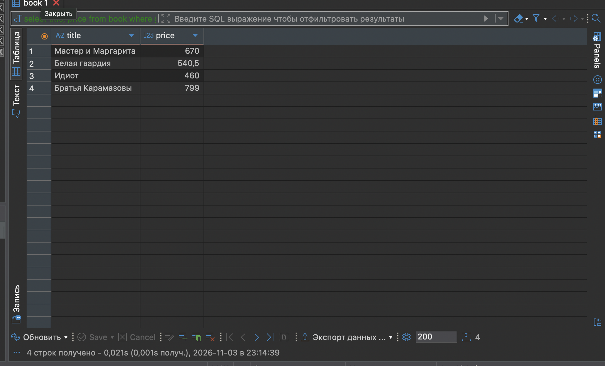

### 6.2. Что хотим получить

Получить авторов, у которых есть хотя бы одна книга дороже 700 рублей.

```sql
SELECT author_id, name_author FROM author
WHERE author_id IN (
    SELECT author_id FROM book WHERE price > 700
);
```

РЕЗУЛЬТАТ ВЫПОЛНЕНИЯ ЗАПРОСА:

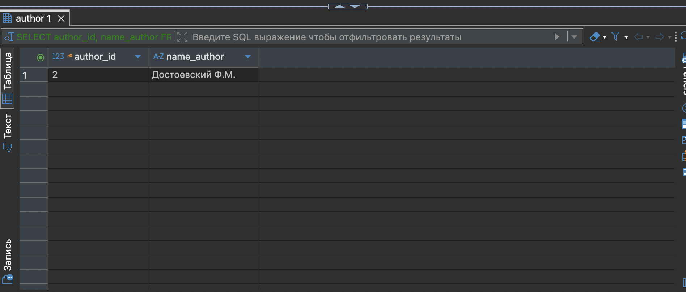

## 7. Подзапросы с ANY

### 7.1. Что хотим получить

Получить книги, которые дороже хотя бы одной книги жанра «Роман».

```sql
SELECT title, price FROM book
WHERE price > ANY (
    SELECT b.price FROM book AS b
    JOIN genre AS g ON g.genre_id = b.genre_id
    WHERE g.name_genre = 'Роман'
);
```

РЕЗУЛЬТАТ ВЫПОЛНЕНИЯ ЗАПРОСА:

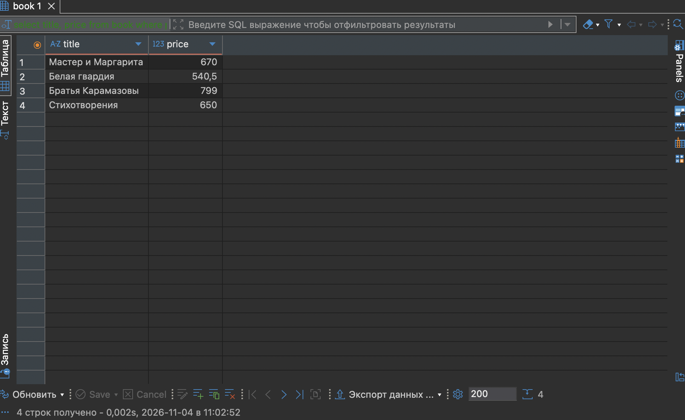

### 7.2. Что хотим получить

Получить книги, количество экземпляров которых меньше количества экземпляров хотя бы одной книги жанра «Поэзия».

```sql
SELECT title, amount FROM book
WHERE amount < ANY (
    SELECT b.amount FROM book AS b
    JOIN genre AS g ON g.genre_id = b.genre_id
    WHERE g.name_genre = 'Поэзия'
);
```

РЕЗУЛЬТАТ ВЫПОЛНЕНИЯ ЗАПРОСА:

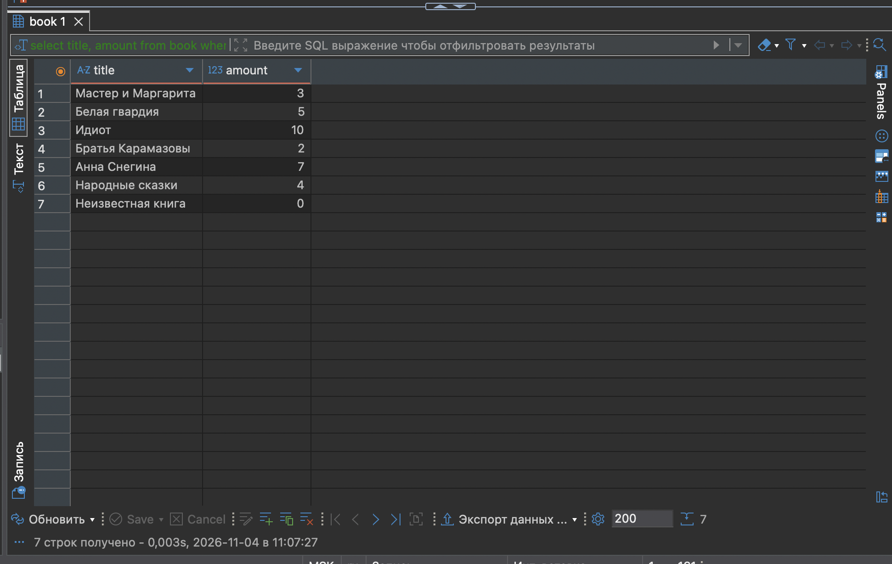

## 8. Подзапросы с EXISTS

### 8.1. Что хотим получить

Получить авторов, у которых есть хотя бы одна книга в таблице book.

```sql
SELECT a.author_id, a.name_author FROM author AS a
WHERE EXISTS (
    SELECT 1 FROM book AS b WHERE b.author_id = a.author_id
);
```

РЕЗУЛЬТАТ ВЫПОЛНЕНИЯ ЗАПРОСА:

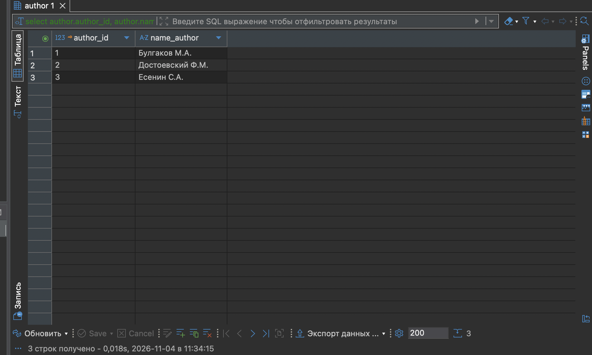

### 8.2. Что хотим получить

Получить жанры, в которых есть хотя бы одна книга дороже 600 рублей.

```sql
SELECT g.genre_id, g.name_genre FROM genre AS g
WHERE EXISTS (
    SELECT 1 FROM book AS b
    WHERE b.genre_id = g.genre_id AND b.price > 600
);
```

РЕЗУЛЬТАТ ВЫПОЛНЕНИЯ ЗАПРОСА:

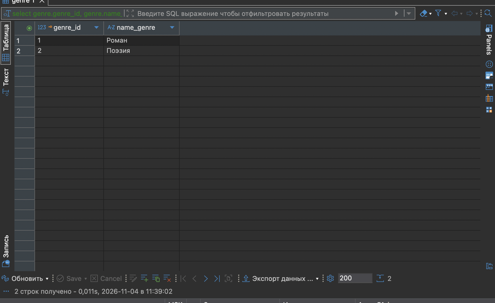

## 9. Сравнение по нескольким столбцам

### 9.1. Что хотим получить

Получить самые дорогие книги каждого жанра, включая все книги с одинаковой максимальной ценой.

```sql
SELECT title, genre_id, price FROM book
WHERE (genre_id, price) IN (
    SELECT genre_id, MAX(price) FROM book GROUP BY genre_id
);
```

РЕЗУЛЬТАТ ВЫПОЛНЕНИЯ ЗАПРОСА:

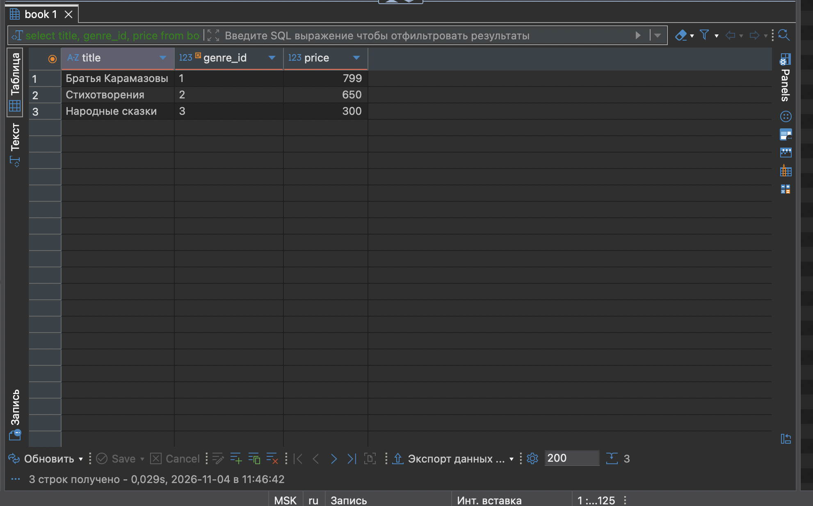

### 9.2. Что хотим получить

Получить другие книги того же автора и жанра, что и книга с book_id = 1.

```sql
SELECT book_id, title, author_id, genre_id FROM book
WHERE (author_id, genre_id) = (
    SELECT author_id, genre_id FROM book WHERE book_id = 1
)
AND book_id <> 1;
```

РЕЗУЛЬТАТ ВЫПОЛНЕНИЯ ЗАПРОСА:

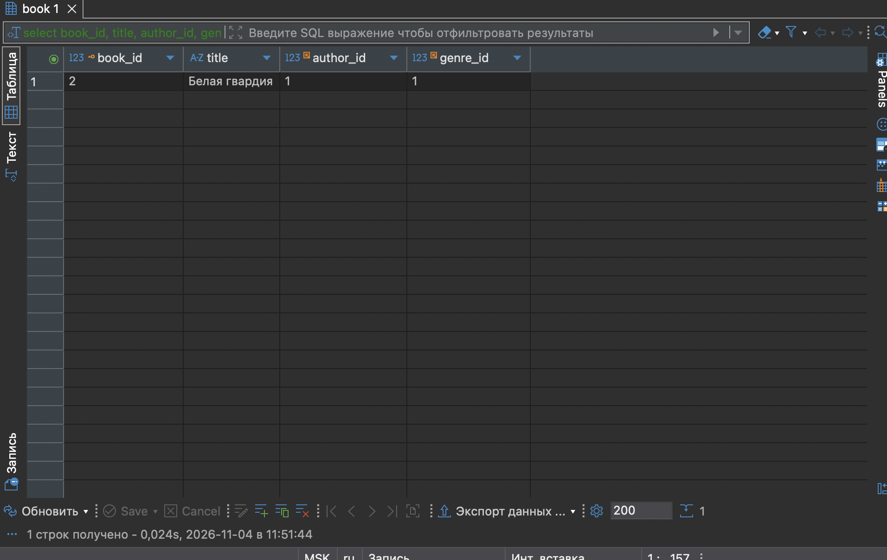

## 10. Коррелированные подзапросы

### 10.1. Что хотим получить

Получить книги, цена которых выше средней цены книг своего жанра.

```sql
SELECT b.title, b.price, b.genre_id FROM book AS b
WHERE b.price > (
    SELECT AVG(b2.price) FROM book AS b2
    WHERE b2.genre_id = b.genre_id
);
```

РЕЗУЛЬТАТ ВЫПОЛНЕНИЯ ЗАПРОСА:

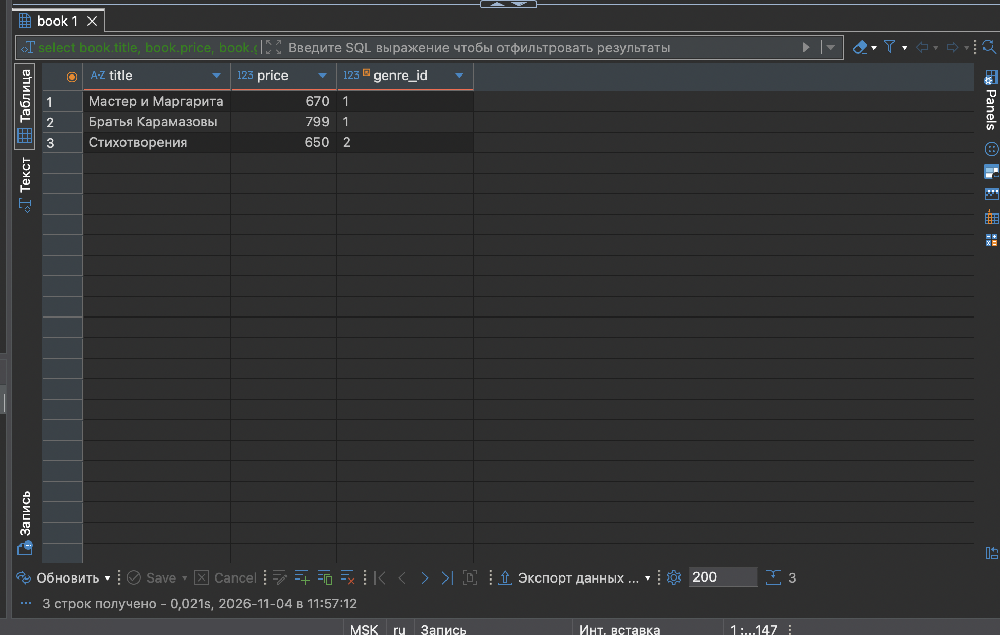

### 10.2. Что хотим получить

Получить книги, количество экземпляров которых меньше среднего количества экземпляров книг того же автора.

```sql
SELECT b.title, b.amount, b.author_id FROM book AS b
WHERE b.amount < (
    SELECT AVG(b2.amount) FROM book AS b2
    WHERE b2.author_id = b.author_id
);
```

РЕЗУЛЬТАТ ВЫПОЛНЕНИЯ ЗАПРОСА:

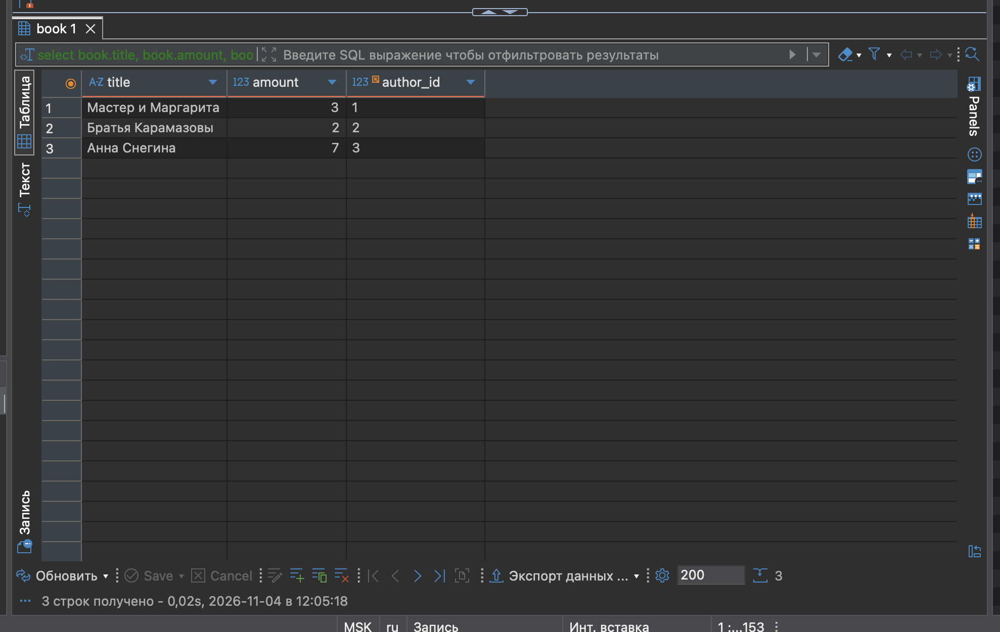

### 10.3. Что хотим получить

Получить каждого автора и число названий его книг, включая авторов без книг.

```sql
SELECT a.name_author,
       (SELECT COUNT(*) FROM book AS b
        WHERE b.author_id = a.author_id) AS book_count
FROM author AS a;
```

РЕЗУЛЬТАТ ВЫПОЛНЕНИЯ ЗАПРОСА:

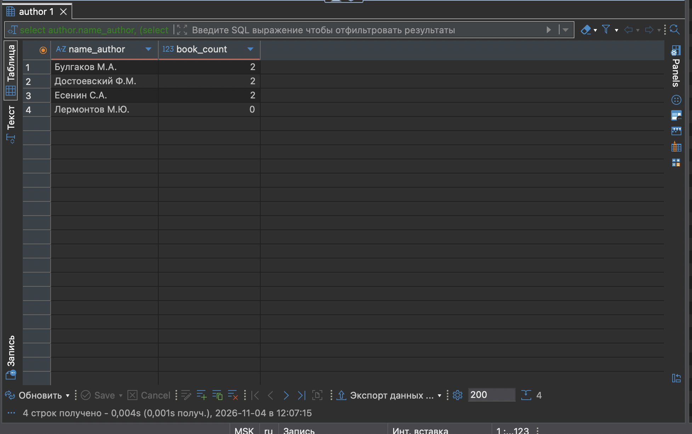

### 10.4. Что хотим получить

Получить жанры, для которых нет ни одной книги в таблице book.

```sql
SELECT g.genre_id, g.name_genre FROM genre AS g
WHERE NOT EXISTS (
    SELECT 1 FROM book AS b WHERE b.genre_id = g.genre_id
);
```

РЕЗУЛЬТАТ ВЫПОЛНЕНИЯ ЗАПРОСА:

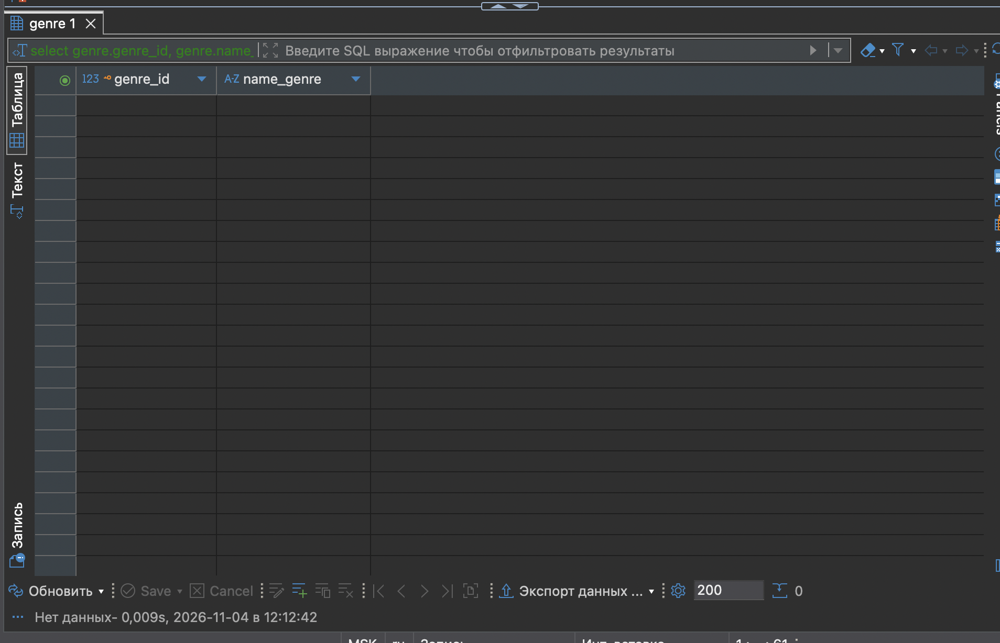

### 10.5. Что хотим получить

Получить самые дешёвые книги каждого автора, включая все книги с одинаковой минимальной ценой.

```sql
SELECT b.title, b.author_id, b.price FROM book AS b
WHERE b.price = (
    SELECT MIN(b2.price) FROM book AS b2
    WHERE b2.author_id = b.author_id
);
```

РЕЗУЛЬТАТ ВЫПОЛНЕНИЯ ЗАПРОСА:

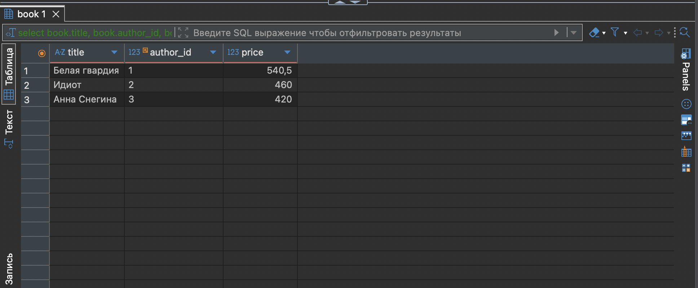

