# CTE, операции над множествами и оконные функции

## 1. CTE

### 1.1. Книги дороже средней цены

**Что хотим получить.** Вывести название и цену каждой книги, которая стоит дороже средней цены по каталогу.

```sql
with average_price as (
    select avg(price) as avg_price
    from book
)
select book.title, book.price, round(average_price.avg_price, 2) as avg_price
from book
cross join average_price
where book.price > average_price.avg_price
order by book.price desc, book.book_id;
```

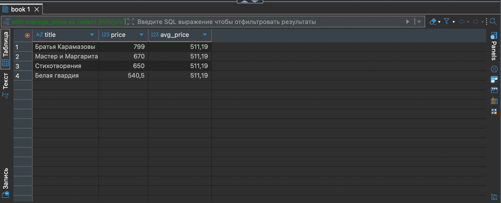

### 1.2. Авторы с двумя книгами и более

**Что хотим получить.** Показать авторов, у которых в каталоге есть хотя бы две книги, и вывести их количество.

```sql
with books_by_author as (
    select author_id, count(*) as book_count
    from book
    group by author_id
)
select author.name_author, books_by_author.book_count
from author
join books_by_author on books_by_author.author_id = author.author_id
where books_by_author.book_count >= 2
order by books_by_author.book_count desc, author.author_id;
```

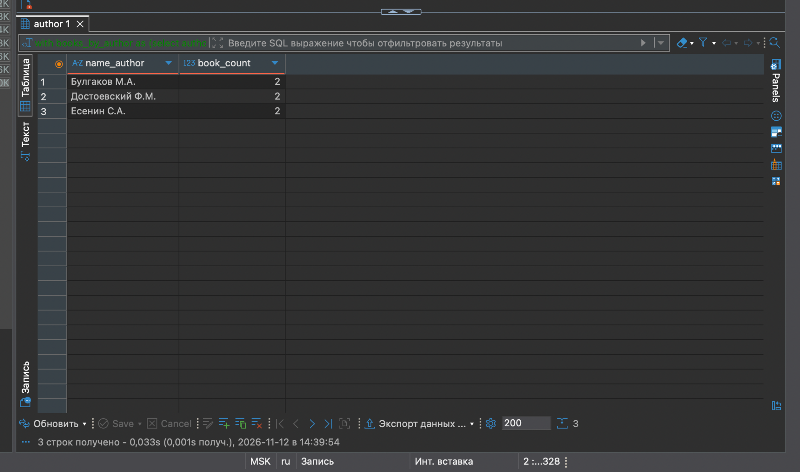

### 1.3. Стоимость запасов по жанрам

**Что хотим получить.** Для каждого жанра посчитать, сколько стоят все экземпляры книг на складе.

```sql
with book_stock as (
    select genre_id, price * amount as stock_value
    from book
)
select genre.name_genre, sum(book_stock.stock_value) as total_value
from genre
join book_stock on book_stock.genre_id = genre.genre_id
group by genre.genre_id, genre.name_genre
order by total_value desc, genre.genre_id;
```

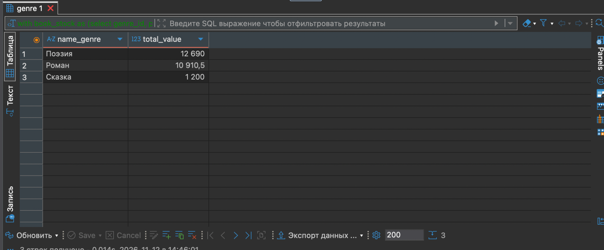

## 2. UNION, INTERSECT и EXCEPT

### 2.1. UNION

**Что хотим получить.** Вывести книги, которые стоят от 500 рублей или есть в количестве от 10 экземпляров.

```sql
select book_id, title, price, amount
from book
where price >= 500
union
select book_id, title, price, amount
from book
where amount >= 10
order by book_id;
```

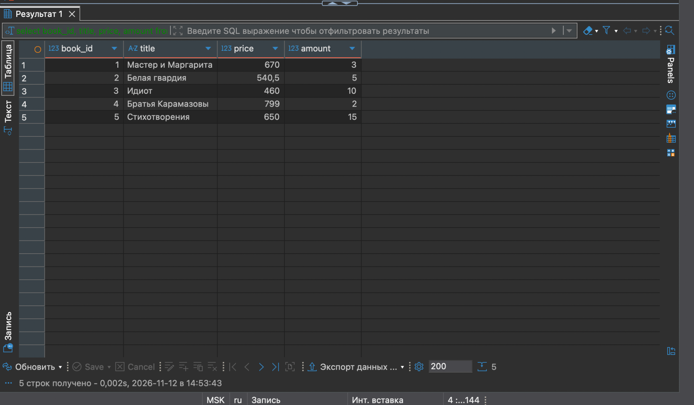

### 2.2. INTERSECT

**Что хотим получить.** Вывести книги, которые стоят от 500 рублей и есть в количестве от 10 экземпляров.

```sql
select book_id, title, price, amount
from book
where price >= 500
intersect
select book_id, title, price, amount
from book
where amount >= 10
order by book_id;
```

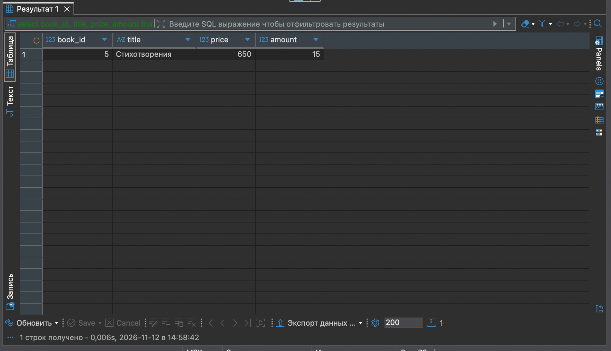

### 2.3. EXCEPT

**Что хотим получить.** Из книг стоимостью от 500 рублей выбрать те, у которых меньше 10 экземпляров на складе.

```sql
select book_id, title, price, amount
from book
where price >= 500
except
select book_id, title, price, amount
from book
where amount >= 10
order by book_id;
```

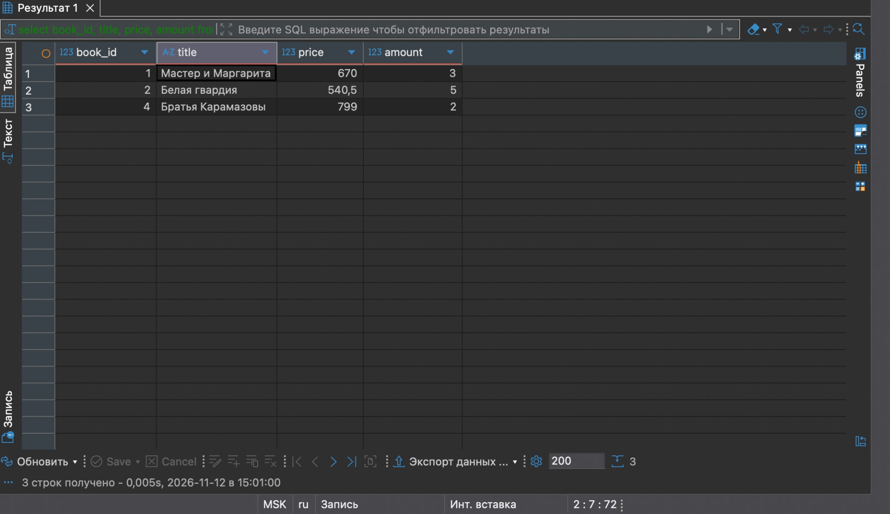

## 3. Оконные функции

### 3.1. PARTITION BY

#### 3.1.1. Средняя цена по жанру

**Что хотим получить.** Для каждой книги с указанным жанром вывести её цену и среднюю цену книг этого жанра.

```sql
select
    genre.name_genre,
    book.title,
    book.price,
    round(avg(book.price) over (partition by book.genre_id), 2) as genre_avg_price
from book
join genre on genre.genre_id = book.genre_id
order by genre.name_genre, book.book_id;
```

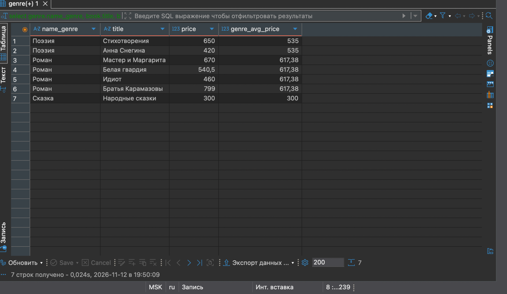

#### 3.1.2. Общее количество экземпляров по автору

**Что хотим получить.** Для каждой книги с указанным автором показать её остаток и суммарный остаток всех книг этого автора.

```sql
select
    author.name_author,
    book.title,
    book.amount,
    sum(book.amount) over (partition by book.author_id) as author_total_amount
from book
join author on author.author_id = book.author_id
order by author.name_author, book.book_id;
```

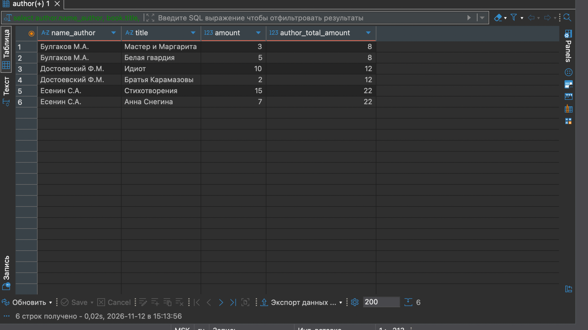

### 3.2. PARTITION BY + ORDER BY

#### 3.2.1. Нумерация книг каждого автора

**Что хотим получить.** Пронумеровать книги каждого автора от самой дорогой к самой дешёвой.

```sql
select
    author.name_author,
    book.title,
    book.price,
    row_number() over (
        partition by book.author_id
        order by book.price desc, book.book_id
    ) as book_number
from book
join author on author.author_id = book.author_id
order by author.name_author, author.author_id, book_number;
```

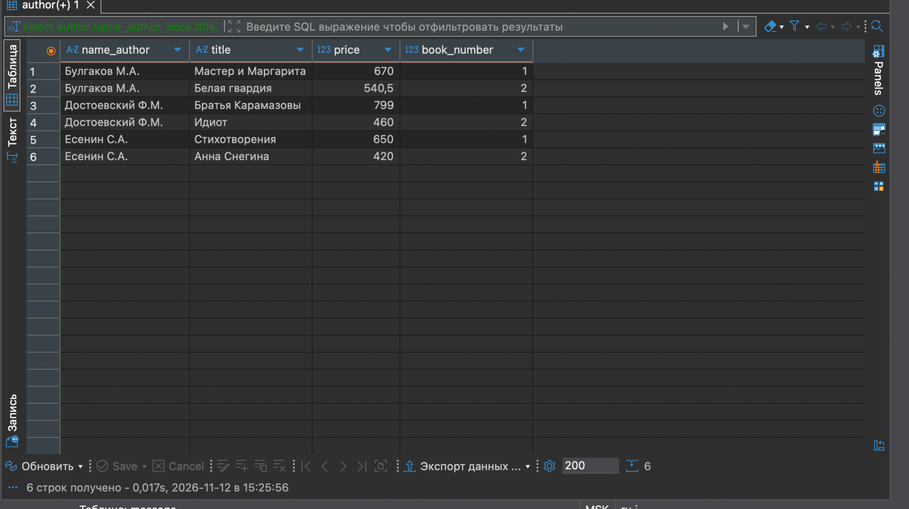

#### 3.2.2. Накопительное количество экземпляров по жанру

**Что хотим получить.** Внутри каждого жанра отсортировать книги по ID и посчитать сумму экземпляров от первой книги до текущей.

```sql
select
    genre.name_genre,
    book.book_id,
    book.title,
    book.amount,
    sum(book.amount) over (
        partition by book.genre_id
        order by book.book_id
    ) as running_amount
from book
join genre on genre.genre_id = book.genre_id
order by genre.name_genre, book.book_id;
```

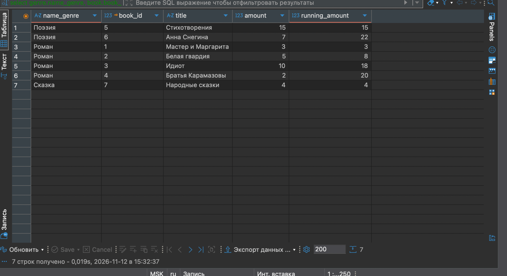

### 3.3. ROWS

#### 3.3.1. Сумма по текущей и предыдущей строкам

**Что хотим получить.** Отсортировать книги по цене и для каждой книги сложить её остаток с остатком предыдущей книги.

```sql
select
    title,
    price,
    amount,
    sum(amount) over (
        order by price, book_id
        rows between 1 preceding and current row
    ) as amount_with_previous
from book
order by price, book_id;
```

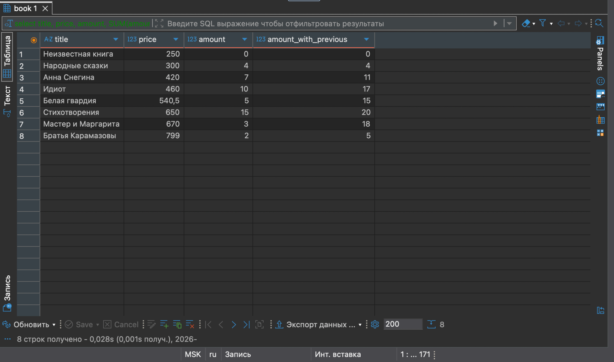

#### 3.3.2. Средняя цена по соседним строкам

**Что хотим получить.** Для каждой книги посчитать среднюю цену по ней самой и её соседям в порядке ID.

```sql
select
    book_id,
    title,
    price,
    round(avg(price) over (
        order by book_id
        rows between 1 preceding and 1 following
    ), 2) as nearby_avg_price
from book
order by book_id;
```

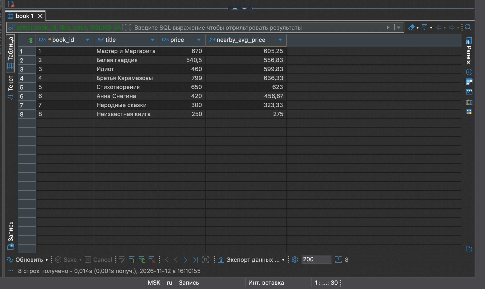

### 3.4. RANGE

#### 3.4.1. Накопительное количество экземпляров по цене

**Что хотим получить.** Для каждой книги посчитать общее количество экземпляров книг, которые стоят столько же или дешевле.

```sql
select
    title,
    price,
    amount,
    sum(amount) over (
        order by price
        range between unbounded preceding and current row
    ) as total_amount_up_to_price
from book
order by price, book_id;
```

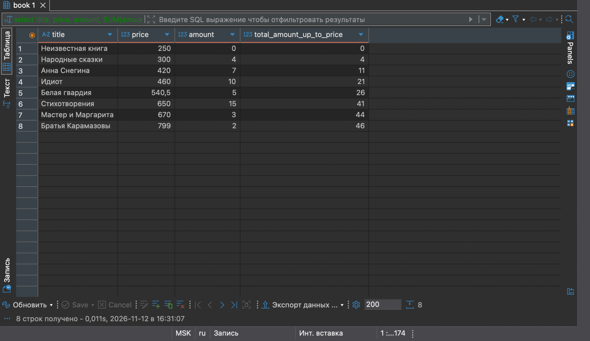

#### 3.4.2. Количество книг в диапазоне цен

**Что хотим получить.** Для каждой книги посчитать, сколько книг стоят от её цены минус 100 рублей до её цены включительно.

```sql
select
    title,
    price,
    count(*) over (
        order by price
        range between 100 preceding and current row
    ) as books_in_price_range
from book
order by price, book_id;
```

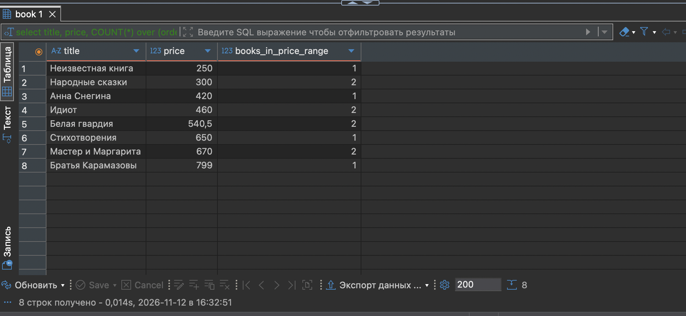

### 3.5. Ранжирующие функции

#### 3.5.1. ROW_NUMBER

**Что хотим получить.** Пронумеровать все книги от самой дорогой к самой дешёвой. При равной цене первой идёт книга с меньшим ID.

```sql
select
    title,
    price,
    row_number() over (order by price desc, book_id) as book_number
from book
order by book_number;
```

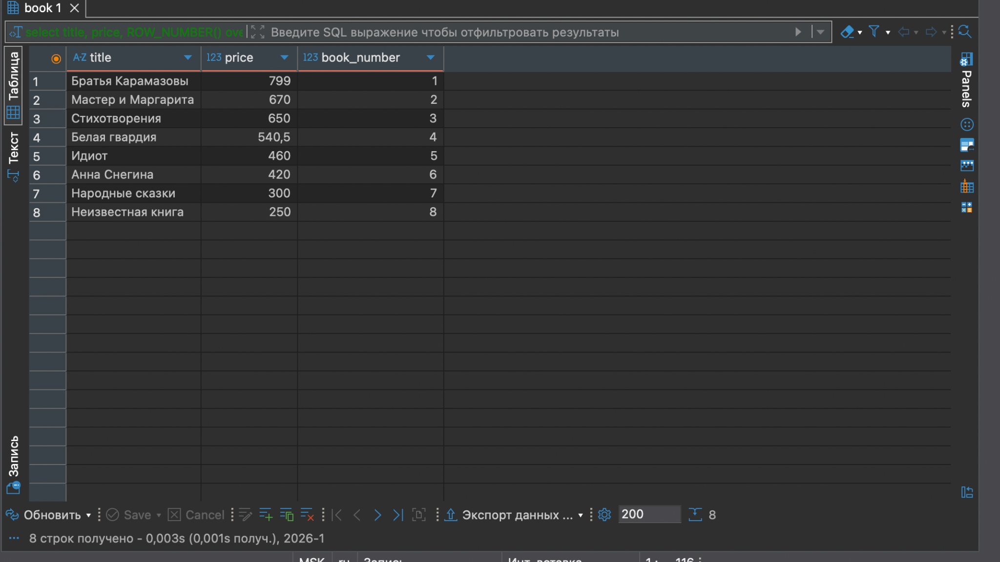

#### 3.5.2. RANK

**Что хотим получить.** Определить место каждой книги по цене. Книги с одинаковой ценой делят одно место, поэтому дальше возможен пропуск.

```sql
select title, price, rank() over (order by price desc) as price_rank
from book
order by price desc, book_id;
```

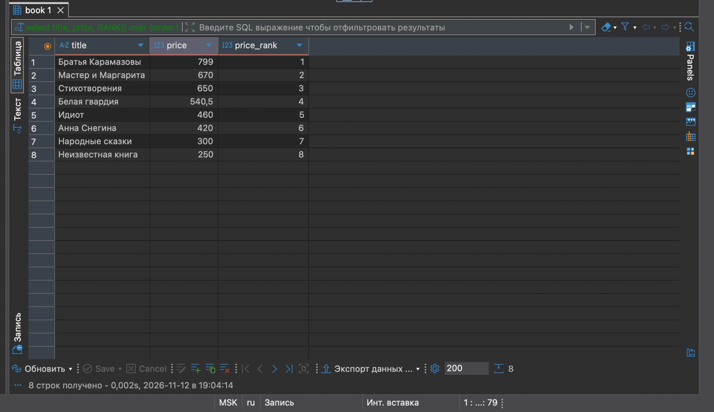

#### 3.5.3. DENSE_RANK

**Что хотим получить.** Определить место каждой книги по цене без пропусков после одинаковых мест.

```sql
select title, price, dense_rank() over (order by price desc) as price_rank
from book
order by price desc, book_id;
```

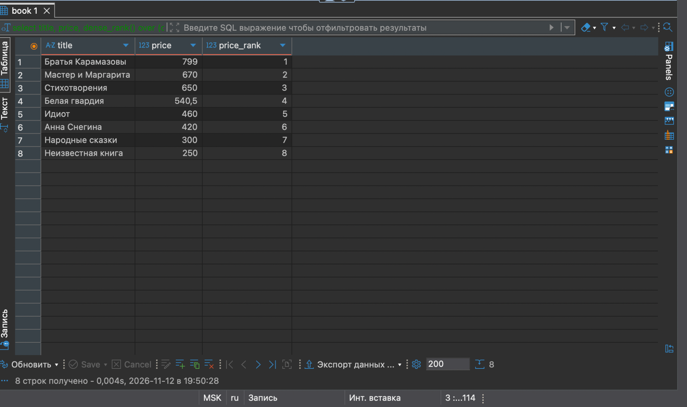

### 3.6. Функции смещения

#### 3.6.1. LAG

**Что хотим получить.** Для каждой книги показать цену предыдущей книги в порядке ID. Для первой книги значение будет NULL.

```sql
select book_id, title, price,
    lag(price) over (order by book_id) as previous_price
from book
order by book_id;
```

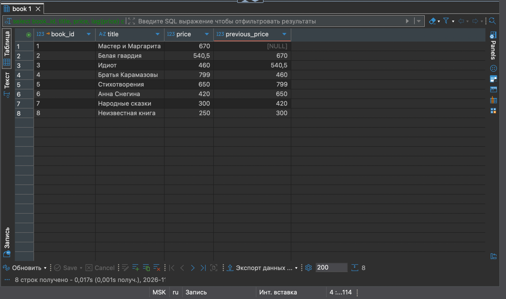

#### 3.6.2. LEAD

**Что хотим получить.** Для каждой книги показать следующую книгу того же автора в порядке ID. Для последней книги автора значение будет NULL.

```sql
select
    author.name_author,
    book.title,
    lead(book.title) over (
        partition by book.author_id
        order by book.book_id
    ) as next_title
from book
join author on author.author_id = book.author_id
order by author.name_author, author.author_id, book.book_id;
```

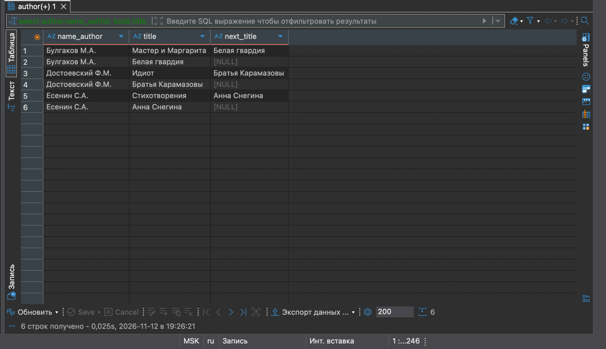

#### 3.6.3. FIRST_VALUE

**Что хотим получить.** Для каждой книги с указанным жанром показать название самой дорогой книги этого жанра. При равной цене выбрать книгу с меньшим ID.

```sql
select
    genre.name_genre,
    book.title,
    book.price,
    first_value(book.title) over (
        partition by book.genre_id
        order by book.price desc, book.book_id
    ) as most_expensive_title
from book
join genre on genre.genre_id = book.genre_id
order by genre.name_genre, book.price desc, book.book_id;
```

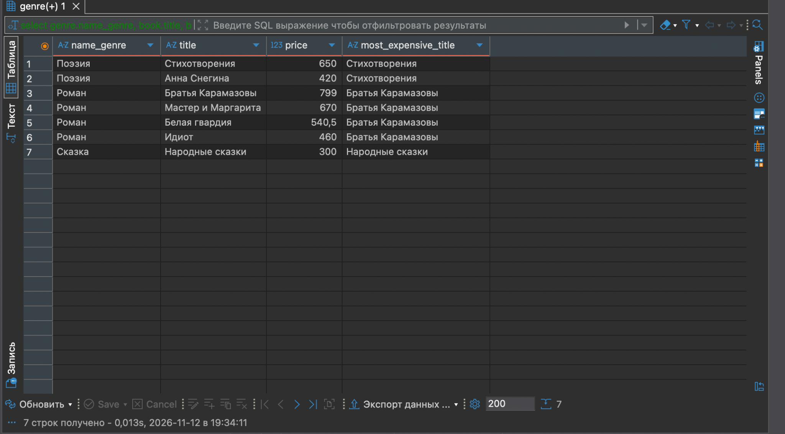

#### 3.6.4. LAST_VALUE

**Что хотим получить.** Для каждой книги с указанным автором показать минимальную цену среди книг этого автора.

```sql
select
    a.name_author,
    b.title,
    b.price,
    last_value(b.price) over (
        partition by b.author_id
        order by b.price desc, b.book_id
        rows between unbounded preceding and unbounded following
    ) as cheapest_price
from book as b
join author as a on a.author_id = b.author_id
order by a.name_author, a.author_id, b.price desc, b.book_id;
```

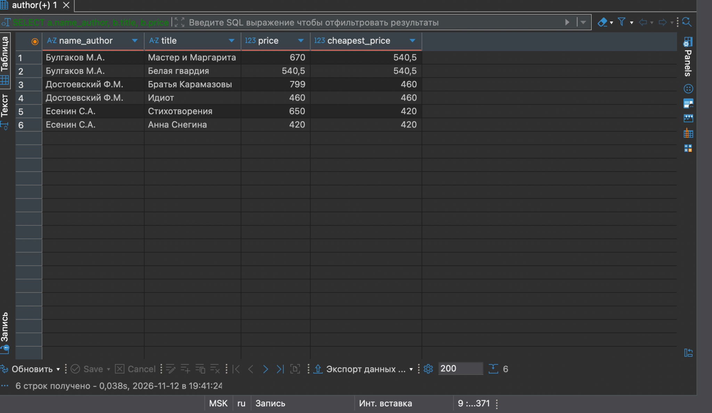
